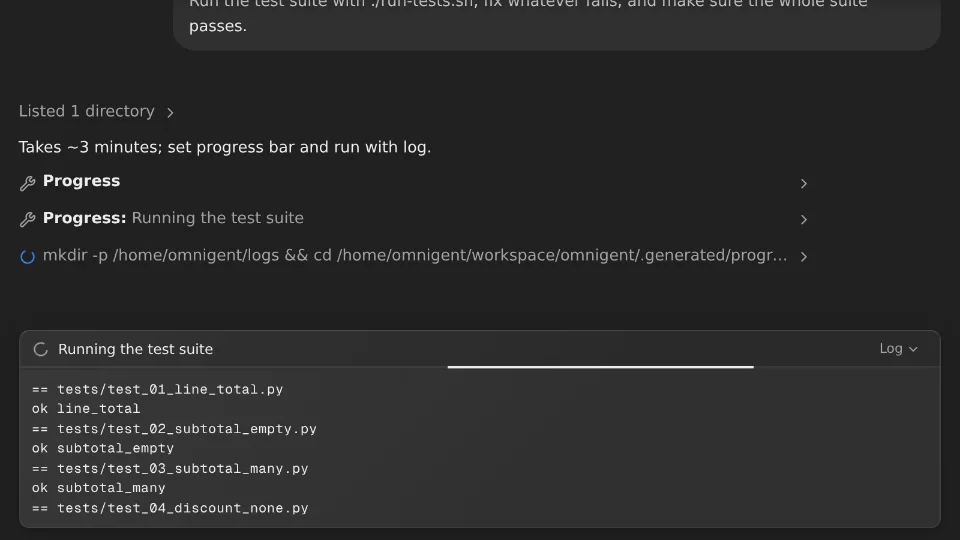
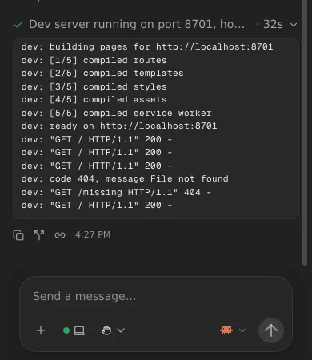

# Progress bars from the agent

While an agent works through something long, such as a migration across many
files, a test run or a batch job, it shows you a small progress bar in the
chat: what it's doing and how far along it is. When it names the file the
work writes its output to, you can open that log under the bar and watch it
come in, also after the agent is done, as with a dev server it started.

## What you see

**While the agent works**, its bar sits at the bottom of the chat, just
above **Working…**, as one line:

- **The label** says what's running, often with counts, such as
  `Migrating settings pages (12/40)`. When a long label doesn't fit, it's cut,
  but a count at its end stays in view.
- **The percentage**, and a thin line along the bar's bottom edge that fills
  to it, when the agent can tell how far along it is. Without one, the line
  sweeps back and forth: the agent is busy, such as with a test suite, but
  can't say how far it's got. At 100%, the spinner in front of the label
  turns into a ✓.
- **Log**, when the agent named a log file. It opens the file's lines as they
  come in.

**Once the agent's turn ends**, its last bar stays in the chat, folded into
one line at the end of the agent's reply: a ✓ (or a red ✗ when the turn
failed), the label the agent left, and how long it ran, such as
`✓ All 40 settings pages migrated · 4m 12s`. Click it to open its log, if it
has one. A dev server's log keeps coming in there, so you can see its
requests and errors while you try the app.

Every device that has the session open sees the same bars, also after a
reload. A log you opened stays open when its bar finishes and moves.

## How the agent uses it

Claude Code and Codex get a tool called `sys_session_progress` (in Claude
Code, `mcp__omnigent__sys_session_progress`). The
[description of the runner](runner-instructions.md) every agent starts with
tells them when and how to use it, so you don't have to ask:

- for work that keeps them busy for more than a minute or two, and for
  something they start that keeps running, such as a dev server;
- set right before each long command; a long loop runs in a few batches, with
  counts and a percentage between them, and one command that does all the
  work gets a bar without a percentage;
- a long command's output goes to a file under `/home/omnigent/logs/`, named
  as the bar's log;
- once more at the end, to say how it went, since that's the line that stays.

You can still ask for one: "show a progress bar while you migrate these".

| Argument | What it does |
| --- | --- |
| `label` | What's running, e.g. `Running the integration tests`. Always needed. Up to 120 characters. |
| `percent` | How far along, 0 to 100. Left out, the bar sweeps. |
| `log_file` | The absolute path of a file the work writes its output to, e.g. `/home/omnigent/logs/tests.log`. Its lines stream under the bar. |
| `clear` | `true` ends the bar now; it stays as a finished line. |

Each call in a turn updates that turn's bar. A message from you starts a new
one, and from the moment you send it, the last turn's bar stays a finished
line at the end of its reply. A label that's empty, a percentage outside 0 to 100 or a log file
that isn't an absolute path comes back to the agent as an error that says
why.

## Good to know

- **A log keeps streaming** while its file grows, also after the agent's
  turn. It stops when the file hasn't grown for 2 hours, or when its bar is
  no longer kept. A file that's emptied and written again, such as by a
  restarted dev server, starts again from its first line.
- **What's kept:** the last 2000 lines of each log, and 1000 characters of
  each line; a session's last 20 bars; and 32 MB of log text across all
  sessions, the logs updated longest ago going first.
- **Where a log starts:** with the last 64 KB of a file written in the last
  30 seconds, such as a dev server's started just before its bar. A file
  nothing wrote for longer is an earlier run's, such as last time's
  `tests.log`, so the log starts with its new lines.
- **Colour codes are dropped**, and a line a tool keeps redrawing, such as a
  spinner, shows as it ends.
- **Repository variable values** of 6 characters or more show as `[hidden]`
  in a log, as in the [startup log](startup-progress.md).
- **It lives in the server's memory.** After the server restarts, earlier bars
  and their logs are gone.
- **Who sees it:** anyone who can read the session can open its logs, like
  its messages. The agent could show any file it can read this way, as it
  could already by printing it in the chat.
- **Sub-agents have their own.** A sub-agent's bars show in its own session,
  not its parent's.
- **Agents don't ask before an update**, with
  [no permission prompts](no-permission-prompts.md). If you turn that off
  for an agent, it may ask before each update, like for other Omnigent
  tools: unlike `sys_session_rename`, Codex doesn't pre-approve it.

## Turning it off

There's nothing to turn off: an agent shows a bar only for long work.

## How it works

- **The tool:** `images/runner/patches/0014-agent-progress.patch` adds
  `sys_session_progress` to the tools the runner relays to Claude Code and
  Codex, beside `sys_session_rename`. The runner posts each call to the
  server and hands the agent back what the server shows, or why it refused.
  It stays out of the tool set every agent registers, which upstream's tests
  pin, so agents on other harnesses don't get it. For a `log_file`, the
  runner's `omnigent.runner.progress_log` checks the file every second and
  posts its new lines, with variable values hidden.
- **The server:** `images/server/omnigent_progress.py` keeps each session's
  bars and their logs, and sends every change of a bar to the browser as a
  `session.progress` event; the session itself has them as `progress`.
  `images/server/omnigent_progress_api.py` adds
  `POST /v1/sessions/<id>/progress`, which anyone who can edit the session
  can call, and `/progress/<bar>/log` to add lines and, for anyone who can
  read the session, to read them. `images/server/patches/0022-agent-progress.patch`
  mounts the routes, adds the event and the snapshot field, ends a bar when
  the session stops working (a pause under 5 seconds, as Claude's terminal
  takes between steps, doesn't), and starts a new one after a message from
  you.
- **The bar:** `images/server/web-patches/0039-agent-progress.patch` keeps
  the bars in the chat store, shows the newest above **Working…** while its
  turn runs and the server hasn't ended it (a message you've sent but the
  server hasn't confirmed yet already starts a new turn, and **Working…**
  staying lit for a background task, such as a sub-agent, doesn't keep the
  ended turn's bar live), places each finished one at the end of the reply of the turn it
  was set in, polls an open log every 1.5 seconds, and titles the tool's
  calls in the chat by the bar's label.
