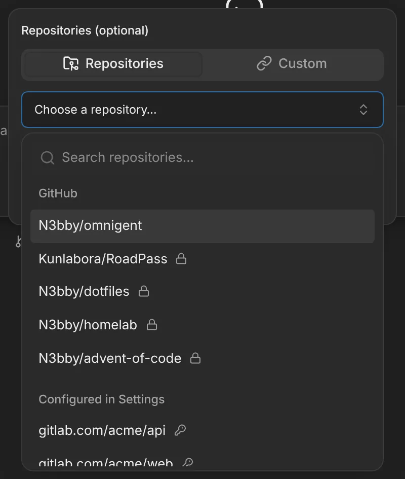
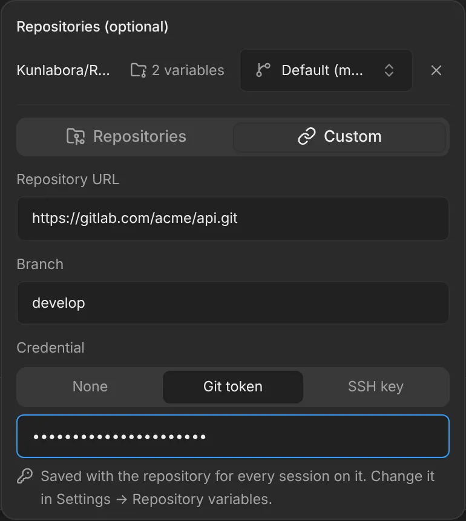
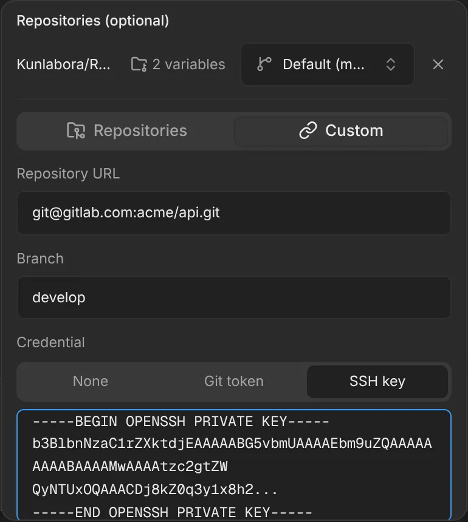
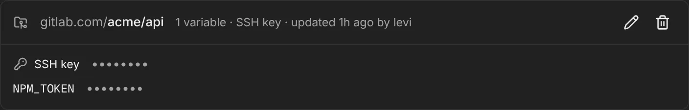
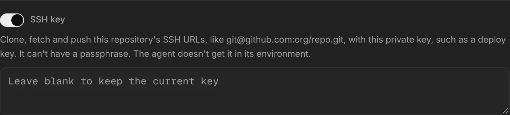

# A repository by its URL, with its own token or SSH key

The new-session repository picker has two tabs. **Repositories** lists the
repositories of your GitHub connection, and below them every repository
configured in Settings → Repository variables, on any host. **Custom** takes
any repository by its URL, on GitHub, GitLab or anywhere else, with a branch.
If you're an admin, you can give it its own Git token or SSH key there, so
sessions can clone and push it.

## Pick a configured repository

Open the repository chip on the **New session** screen. On the
**Repositories** tab, the list has two groups: **GitHub**, your GitHub
connection's repositories, and **Configured in Settings**, every repository
with variables, a Git token or an SSH key, such as `gitlab.com/acme/api`. A
key marks those with their own token or key.

A configured repository is cloned with its SSH URL if it only has an SSH key,
and with its HTTPS URL otherwise. Type its branch next to it, or leave it on
the default branch. A github.com repository that's in your GitHub list is
only listed there, with its branch menu.

## Add a repository by its URL

1. On the **New session** screen, open the repository chip and choose
   **Custom**.
2. Paste an HTTPS URL, like `https://gitlab.com/acme/api.git`, or an SSH URL,
   like `git@gitlab.com:acme/api.git`. Fill in **Branch**, or leave it on the
   default branch.
3. Choose **Add**.

Without the [GitHub App](github-repo-picker.md) there are no tabs, only this
form.

## Give it a Git token or SSH key

Admins see a **Credential** choice under the URL: **None**, **Git token** or
**SSH key**. Pick one, paste it, and choose **Save and add**.

- **Git token:** for an HTTPS URL. On GitHub, use a
  [fine-grained token](repo-git-token.md#set-it-up) for that one repository.
- **SSH key:** for an SSH URL. Use a private key without a passphrase, such as
  a [deploy key](https://docs.github.com/en/authentication/connecting-to-github-with-ssh/managing-deploy-keys)
  made for this repository, with write access if the agent should push.

  

The token or key is saved with the repository, like the
[Git token in Settings](repo-git-token.md), and every later session on the
repository uses it. Your other variables for it stay as they are. If the
repository already has one, the field says a new one replaces it.

Settings → Repository variables shows it on the repository's card, where you
can replace it or turn it off. Like a variable's value, it can be replaced but
not shown again; leave the field blank to keep it.

## Good to know

- **Only admins can save one.** Other users see the URL and branch fields,
  and a line saying an admin can add a token or key.
- **The URL decides which one is used.** A token works with HTTPS URLs and a
  key with SSH URLs. The form won't save a token for an SSH URL, or a key for
  an HTTPS URL.
- **The key isn't in the agent's environment,** unlike the token, which the
  agent gets as `GIT_TOKEN`. The agent can still read the mounted file, so
  anyone who starts a session on the repository can use it. See the
  [threat model](../threat-model.md#trade-offs-worth-knowing).
- **The token goes with the username `x-access-token`.** GitHub expects
  that, and GitLab takes any username with a token. A host that needs your
  own username needs an SSH key instead.
- **A key with a passphrase is refused** when you save it, as is a public
  key. Sessions can't type a passphrase.
- **The first connection trusts the server's host key,** and remembers it in
  the session's home directory.
- **Everyone signed in sees the configured repositories** in the list, by
  name, whether or not they've connected GitHub; never a value. Anyone who
  starts a session on one gets its variables and credentials anyway.
- **A github.com repository with a token is also in the GitHub group**, with
  its branches, for everyone who has connected GitHub, as described in
  [a repository's own Git token](repo-git-token.md).
- **Without a working token or key, the session doesn't start.** The clone
  fails, and the [startup card](startup-progress.md) shows Git's error.

## Turning it off

Edit the repository in Settings → Repository variables and turn off **Git
token** or **SSH key**. Removing the repository there takes it out of the
list. There's nothing to turn off for the tabs.

## How it works

- **The tabs and the form**
  (`images/server/web-patches/0031-repo-picker-tabs.patch`): the repository
  popover in `web/src/shell/NewChatDialog.tsx` puts the repository combobox
  and `web/src/components/RepoCustomForm.tsx` on two tabs. The combobox
  lists the GitHub repositories and, in their own group, those from
  `GET /v1/repo-env/repositories`, asked for when the popover first opens.
  The form saves a credential with `PUT /v1/repo-env/credentials` before it
  adds the repository. The same patch adds the SSH key switch to Settings →
  Repository variables.
- **The list:** `picker_repositories` in `images/server/omnigent_repo_env.py`
  reads the repositories' Secrets and returns each repository with its clone
  URL and whether it has a token or key, never a value.
- **The route:** `save_credentials` in `images/server/omnigent_repo_env.py`,
  served by `images/server/omnigent_repo_env_api.py` for admins only. It sets
  only `GIT_TOKEN` or the key in the repository's
  [Secret](repo-env.md#how-it-works) and keeps everything else.
- **The key:** stored as `git-ssh-key`. That isn't a variable name, so the
  agent wrappers don't export it. `check_ssh_key` normalises line ends, adds
  the final newline `ssh` needs, and refuses public keys and keys with a
  passphrase.
- **The clone:** for a `git@…` or `ssh://` URL whose Secret has the key,
  `clone_command` clones with a `core.sshCommand` and writes the same one to
  the checkout's `.git/config`, so fetch and push keep using it. The mounted
  file is readable by its group, which `ssh` refuses, so the command copies it
  to a private temporary file for each connection and deletes it afterwards.
  Without the file, it's plain `ssh`. The key itself is never written to the
  checkout.
