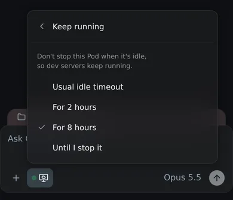

# The environment menu

See what a session's sandbox is doing, keep it running, stop it or start it
again, from the composer. The menu opens from the monitor icon left of the permission
picker. Its dot shows the sandbox's state at a glance:

| Dot | State | What it means |
| --- | --- | --- |
| solid green | **Running** | The agent is working on your message. |
| faded green | **Idle** | The Pod is up and the agent is waiting, or the agent exited after its idle timeout and starts again with your next message or **Start agent**. |
| hollow ring | **Stopped** | The Pod is stopped. Its files are kept, and your next message starts it again. |
| pulsing amber | **Starting** | The Pod or the agent is starting. The menu shows which step it's on. |
| red | **Failed** | The sandbox couldn't start. The menu says why. |

## What's in it

While the sandbox is up, the menu shows:

| Row | Example | What it means |
| --- | --- | --- |
| **Agent** | `Idle 12m · exits in 18m` | Whether the agent is working, how long it has been idle, and when it exits if nothing happens. |
| **Pod** | `Up 1h 03m · 2 CPU, 8 GB` | How long the Pod has run, and the CPUs and memory it's using now, not its limits. A stopped Pod shows when it stopped. |
| **Exit node** | `cronos-vpn · connected` | Only when the session's repositories name a [tailnet exit node](repo-exit-node.md): whether it's online. In red while it's offline, when the session has no internet, or when Tailscale refused it; in amber when the repositories name different ones and the session uses none. |
| **VM disk** | `59 of 193 GB` | The VM's whole disk, which every session's files and Pods share. The bar turns amber at 80% and red at 90%, when Kubernetes starts stopping Pods to free space. |
| **Idle stop** | `Pod stops in 48m · at 15:12` | When the Pod stops if nothing happens: 30 minutes after the agent exits. Never while the agent is working, and not while you keep it running (`Kept running · until 23:00`). |

The menu refreshes them every few seconds while it's open. Then:

- **Copy SSH command** copies `ssh root@omnigent-<id>`, the Pod's MagicDNS
  short name, as in the menu's header. It works from any device on [your
  tailnet](tailscale.md) that uses Tailscale's DNS, and isn't there when the
  session isn't on your tailnet.
- **Keep running** stops the Pod from stopping when it's idle, so dev servers
  in the agent's terminal keep running: **For 2 hours**, **For 8 hours** or
  **Until I stop it**. **Usual idle timeout** goes back to normal. It isn't
  there once the agent has exited, because the agent's runner is what keeps
  the Pod going; send a message first. On a phone, its choices replace the
  menu, with **‹ Keep running** to go back:

  

- **Restart agent** stops the agent and keeps the Pod, with everything
  running in it. Your next message starts the agent again. It's what you use
  to pick up another [subscription](subscriptions.md) account.
- **Start agent** starts an agent that has exited without sending a message,
  in the Pod that's still up. It's where Restart agent is while the agent
  isn't running.
- **Stop sandbox** stops the agent and the whole Pod, after you confirm. See
  below.
- **Start now** starts a stopped sandbox without sending a message, and
  **Try again** starts one that failed to start.
- **Cancel start** stops a Pod that's starting again, as Stop sandbox does. A
  message you sent to wake it isn't sent.
- **Copy error details** copies why the sandbox couldn't start, in full.

Keep running, Restart agent, Start agent, Stop sandbox, Start now, Try again
and Cancel start are greyed out unless the session is yours.

## Stop a sandbox

Stop a session's sandbox when you're done with it for now, instead of waiting
for it to [stop on its own](idle-sessions.md). Choose **Stop sandbox** in the
environment menu, or in the session's **⋯** menu in the sidebar (on a phone,
swipe the session left), and confirm.

The agent and everything running in the session's Pod stop straight away,
including dev servers and containers, and the Pod is gone within about 30
seconds. That frees its CPU and memory, the same as an idle stop.

- **Files in `/home/omnigent` are kept**, as when a session stops while idle.
  Everything else in the Pod, such as packages from `apt-get install`, starts
  fresh when it wakes.
- **Your next message starts it again**, taking about as long as a new
  session.
- **It's there after the agent exits.** An idle agent exits after 30 minutes,
  but its Pod keeps running for another 30, so there's still something to
  stop.
- **It ends Keep running.** A sandbox you stop starts again with the usual
  idle timeout.
- **Sessions on your own machines keep Stop session** in the sidebar. It stops
  the agent; the machine keeps running. Their composer keeps the old host
  menu, with Reconnect host and Switch host.

## Good to know about Keep running

- **"Until I stop it" has no limit.** The Pod keeps its CPU and memory, and
  counts towards `runner_max_concurrency`, until you choose **Stop sandbox**
  or **Usual idle timeout**. Nothing outside the menu shows that a session is
  kept running.
- **It's yours.** Only the session's owner can change it.
- **A failed first start has no Try again.** A new session that never got a
  sandbox starts with your next message instead.

## Turning it off

There's nothing to turn off: a sandbox only stops early when you choose
**Stop sandbox** or **Cancel start**, and only stays up longer when you choose
**Keep running**.

## How it works

Before this, **Stop session** only stopped the agent. The Pod kept running
until its idle deadline, 30 minutes later in production, and the next message
started the agent again in the same Pod. So Stop was really "restart the
agent", which is what **Restart agent** now is.

It's one patch per image: the server, the runner and the web UI. The
**Exit node** row is a second set, described in
[a repository's exit node](repo-exit-node.md#how-it-works).

- `images/server/patches/0015-environment-menu.patch`:
  - **Stop sandbox.** `stop_session` takes `data.suspend_sandbox`. With it,
    after stopping the agent, the server suspends the session's Sandbox by
    setting its `spec.shutdownTime` to now (`AgentSandboxLauncher.suspend`).
    The agent-sandbox controller then deletes the Pod and keeps the Sandbox
    and its volume, exactly as when the idle deadline passes. The next message
    wakes it the usual way. While a runner is connected, the server keeps
    pushing that deadline forward, so for two minutes after a stop it leaves
    the stopped Sandbox alone, and the suspend waits behind any refresh
    already queued. Without the flag, `stop_session` works as before: Restart
    agent. A claimed warm-pool Sandbox can't be stopped this way (its handle
    doesn't name it), so it says so rather than doing nothing.
  - **Cancel start.** Stop sandbox while the Sandbox wakes marks the wake
    cancelled. A wake runs on worker threads that can't be interrupted, so it
    stops at its next stage instead: every stage goes through the server's
    sandbox-status publisher, which raises for a cancelled wake, and the
    message waiting on it fails instead of being sent. Once it has stopped,
    the server stops the Sandbox again and shows the session as stopped. Only
    a wake can be cancelled: during a new session's first launch, Stop sandbox
    answers "still being created", since losing its Pod would delete the new
    Sandbox.
  - **Status.** `GET /v1/sessions/{id}/environment` returns when the Pod
    started and the Sandbox's `shutdownTime`, read from Kubernetes, the VM
    disk from `os.statvfs("/")` on the server (one node, one disk), and the
    runner's latest report. The disk's colours come from free space as the
    kubelet counts it for eviction (`f_bavail / f_blocks`), so blocks reserved
    for root can't put them out of step with eviction. Reports are kept in
    memory, and one older than 30 seconds isn't shown.
  - **Keep running** is stored on the session (the
    `omnigent.keep_running_until` label) and sent back to the runner with each
    answer to its report. Stop sandbox clears it.
- `images/runner/patches/0011-environment-menu.patch`:
  - Only the runner knows the Pod's usage and when its agent exits, so it
    reports them to the server every 5 seconds (as often as the open menu
    refreshes), and at once when the agent starts or stops working. CPU comes
    from cgroup v2's `cpu.stat`, memory is `memory.current` less the page
    cache the kernel can drop (the kubelet's working set). The runner pushes
    rather than being asked, because every request it gets through its tunnel
    counts as activity and would keep the agent from ever going idle. The
    reports themselves don't count as activity: the server keeps a Pod alive
    only while its runner's tunnel is connected.
  - While Keep running holds, the runner counts as busy, so it doesn't exit
    for being idle, and its reaper of idle native panes leaves Claude's or
    Codex's terminal alone. The server then keeps extending the Pod's
    deadline as it does for any connected runner. Keep running lapses when the
    server hasn't confirmed it for 90 seconds, so a runner cut off from the
    server still exits when idle.
- `images/server/web-patches/0020-environment-menu.patch`:
  - Replaces the composer's host menu for sandbox sessions with
    `EnvironmentMenu`. Its state comes from what the web UI already knows: the
    session's launch stage, its liveness (from the ~10 s health poll) and
    whether a turn is running. It polls the status endpoint only while it's
    open. Start now, Try again and Start agent use upstream's `retry_session`,
    which wakes a stopped sandbox, or starts the runner on a live Pod, as a
    message would. After Stop, Restart or a start, the menu shows where it's
    heading until the poll catches up.
  - On a phone (narrower than 768px), Keep running swaps the menu for its
    choices in place, as upstream's conversation menu does for Move session:
    a side flyout has no room beside the menu there and opened off the
    screen.
  - Renames the sidebar's item to **Stop sandbox** for sessions on the
    sandbox, sends the flag, and adds the confirmation dialog.
  - The spacing is scoped to `.environment-menu` in `index.css`, and labels
    use `text-box: trim-both cap alphabetic` so icons line up with the capital
    letters (Firefox ignores it and keeps a ~1px offset).
