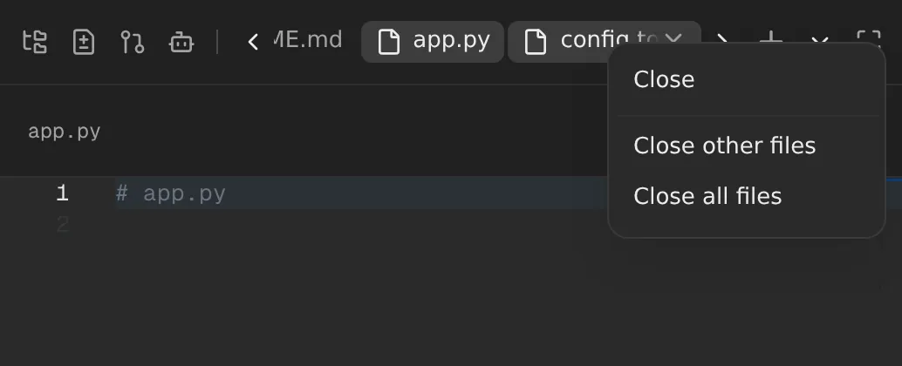

# Close other or all file tabs

Right-click a file tab at the top of the workspace panel, on the right, for
**Close**, **Close other files** and **Close all files**. When you've opened
a dozen files, one click tidies them up instead of a dozen clicks on their ×.

## What you'll notice

- **Close other files** keeps the tab you right-clicked, and shows it if the
  file you were looking at was one of the others. It's greyed out when only
  one file is open.
- **Close all files** closes every file tab and goes back to the list of
  files you were on.
- **Only file tabs close.** Shells, browsers and side chats next to them stay
  open, because closing a shell's tab ends the shell.
- **Close** does what the tab's × does. Middle-clicking a tab still closes it
  too.

## Turning it off

You can't. It's only there when you right-click a file tab.

## How it works

The web UI patch `images/server/web-patches/0045-file-tab-close-menu.patch`
wraps each file tab in `WorkspacePanel.tsx` in a context menu. Its items call
`closeFiles` in `AppShell.tsx` with the tabs to close; the tab's × now calls
it with just its own. When the file you're looking at closes, it picks the
nearest remaining tab to its left, else to its right, as closing one tab
always has.
