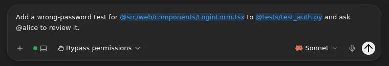
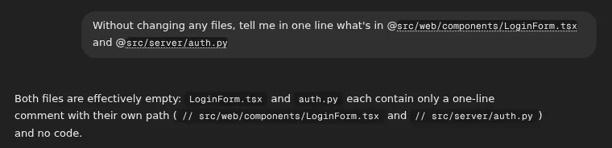

# Fuzzy file search with @

Type `@` and part of a file's name in a session's composer, and the menu
finds it anywhere in the workspace. You don't have to open each folder on
the way. The file you pick goes into your message where you typed it, so you
can write "add a test to @src/app.ts". It works like the `@` picker in
Claude Code and Codex.

## Using it

- **Type part of a name:** `@auth` lists every file and folder that matches,
  best first. Pick one with the arrow keys and Enter, or click it.
- **The letters don't have to be next to each other.** They only have to be
  in the right order, as in fzf: `@srvts` finds `src/server.ts`.
- **The mention stays in your message.** Picking a file replaces what you
  typed after `@` with its path, `@src/web/components/LoginForm.tsx`, and a
  space, so you can keep typing. A folder ends in `/`, and a path with a
  space is quoted: `@"docs/my notes.md"`. Delete it or edit it like any
  other text.
- **Mentions are coloured as you type.** Every path mention in the composer
  shows in the accent colour on a light tint, whether you picked it or typed
  it, so you can see which words are file references. `@alice` and text in
  backticks stay plain.
- **Search one folder:** `@src/au` searches everything under `src`, however
  deep.
- **Folders show up too.** Enter on a folder opens it, and Tab or **+ folder**
  inserts the whole folder.
- **Browsing still works.** A bare `@` lists the workspace's top level, and
  `@src/` lists what's in `src`, as before.

Once it's sent, each path in your message is shown as code, and clicking it
opens the file.

Matches in the file's own name rank above matches in the folders above it.
So do matches at the start of a word, after a `-`, `_` or `.`, or at a
capital letter, and letters typed in a row. Files rank a little above
folders, and shorter paths above longer ones. Typing a capital letter makes
the search match case.

## Good to know

- **The agent reads the path from your message.** Claude Code reads a
  mentioned file itself, the way it does when you type `@` in its terminal.
  Codex and the other agents work in the same workspace and open it from the
  path.
- **"Attach to agent" in the file viewer still adds a chip** under the
  composer, for a range of lines. It's sent as an `[Attached: …]` line
  before your message, as upstream does.

- **Only the session's composer has it.** The `@` menu in the **New
  session** dialog lists the host's files and still browses one folder at a
  time. To search a sandbox before you've decided what to ask,
  [start the session without a message](start-without-message.md).
- **Ignored files aren't listed.** Inside a Git repository the menu offers
  what `git ls-files` lists: tracked files, and new files `.gitignore`
  doesn't exclude. A repository inside another one follows its own
  `.gitignore`. Outside a repository it skips hidden folders, `node_modules`
  and `.venv`.
- **The list loads when you first type `@`.** Until it arrives, the menu
  filters the current folder as before. It reloads when the agent finishes a
  turn, so new files show up.
- **Up to 50,000 files.** In a bigger workspace, files past that aren't
  offered.
- **If the list can't load,** for example while the runner is restarting,
  the menu browses folders as before.

## Turning it off

You can't.

## How it works

| Part | Patch | What it does |
| --- | --- | --- |
| Runner | `images/runner/patches/0006-mention-file-index.patch` | Adds a `file-index` route that lists every file path in the workspace, using `git ls-files` inside repositories |
| Server | `images/server/patches/0011-mention-file-index.patch` | Passes that route through to the runner, with the same access check as the other file reads |
| Web UI | `images/server/web-patches/0014-composer-fuzzy-mentions.patch` | Loads the list once, matches it as you type, and shows the results in the `@` menu |
| Web UI | `images/server/web-patches/0030-inline-file-mentions.patch` | Writes a pick into the message as `@<path>` instead of a chip, colours path mentions in the composer, and shows sent mentions as code paths |

The matching runs in the browser. Once it has 50 results, it skips any path
whose best possible score can't beat the 50th, before matching it. On the
Linux kernel's 96,000 files a keystroke takes under a millisecond on average
and about 3 ms at worst. The scoring follows fzf's. Upstream Omnigent's `@`
menu only filtered the folder you were in, so reaching a nested file meant
opening every folder on the way. It also turned a pick into a chip under the
composer and sent it as an `[Attached: <path>]` line before the message, so
the path couldn't be part of a sentence. The New session screen's `@` menu
writes into the message the same way now.
