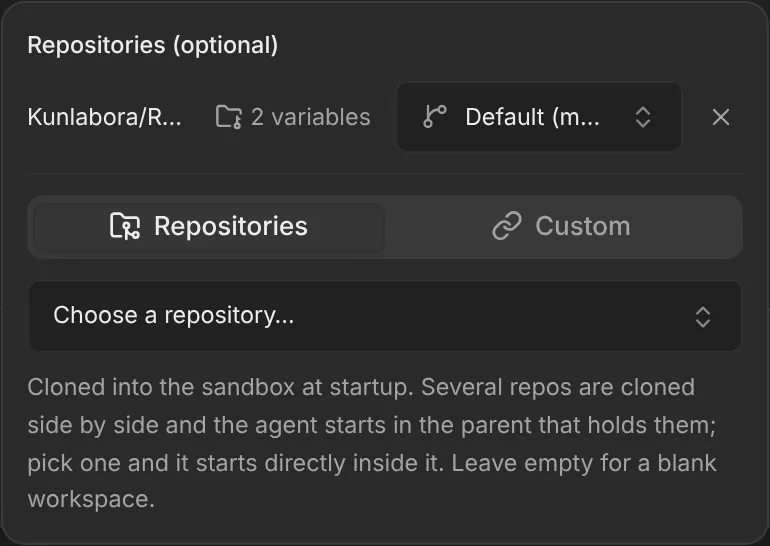
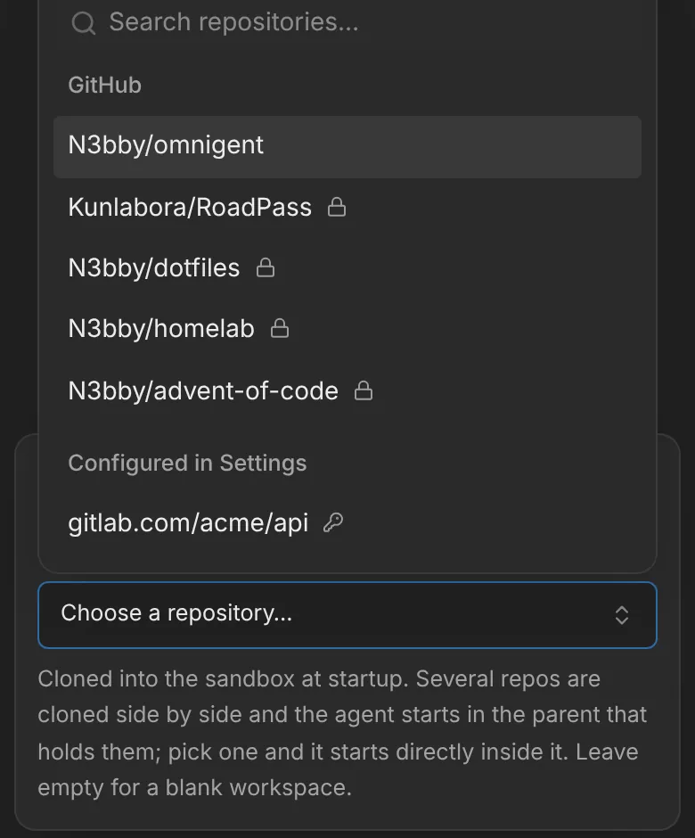

# GitHub repository picker

Connect a GitHub App, and you can pick repositories from your GitHub account
when you start a session. They're on the repository picker's
**Repositories** tab, above the repositories configured in Settings; its
**Custom** tab takes any other repository by its URL (see
[a repository by its URL](custom-repository.md)).

Sessions can clone and push to every repository the App is installed on,
private ones included. You don't also need `mise run setup-git-token`.

## Set it up

1. Run `mise run setup-github-app`. It prints the settings to use for a new
   GitHub App, then asks for its Client ID, Client secret and slug.
2. In Omnigent, go to **Settings → Sandbox Integrations** and connect GitHub.

Each user connects their own GitHub account, so each user gets their own
access.

## A repository is missing

The picker lists the repositories the App is installed on, not every
repository you can open on GitHub. Install the App on the repository's owner,
or add the repository to the installation, under **Repository access** in the
App's installation settings. An organization's owner may have to approve it.

If you can't, give the repository its own token: see
[a repository's own Git token](repo-git-token.md). Or add it under **Custom**
with its URL, and, if you're an admin, a token or SSH key for it: see
[a repository by its URL](custom-repository.md).

## Good to know

- **Tokens are encrypted.** Each user's GitHub tokens are encrypted by a
  small Vault service inside the cluster before they're stored in the
  database. See the [threat model](../threat-model.md#github-tokens-and-vault)
  for what that protects against.
- **It works on phones.** Upstream's picker ran off the top of a phone's
  screen. It's patched to fit the screen, with the list scrolling inside it,
  and the keyboard only opens when you tap the search field.

  
- **It stays put.** The picker's popovers open below their button, or above
  it when there's more room there, and stay on that side while you type,
  pick repositories or open the keyboard. When they run out of room they
  scroll.

## Turning it off

It's an optional setup step. Without it, the **Repositories** tab only lists
the repositories configured in Settings, and without those there are no tabs:
the picker only takes URLs.

## How it works

- Vault runs from `kubernetes/base/vault.yaml`, and uses its Transit engine
  for the encryption.
- The key that unlocks Vault is stored in a Kubernetes Secret, so Vault comes
  back by itself after a restart.
- The server image adds the `hvac` Python client, so the server can talk to
  Vault.
- `images/server/web-patches/0006-mobile-repo-picker.patch` keeps the picker
  on a phone's screen and keeps its popovers from flipping to the other side
  of their button. Radix flips a popover whenever it stops fitting, and the
  picker's size changes as you use it. The same fix applies to the branch
  picker next to a picked repository.
- `images/server/web-patches/0031-repo-picker-tabs.patch` puts the picker on
  the popover's **Repositories** tab, next to the **Custom** tab for any URL: see
  [a repository by its URL](custom-repository.md#how-it-works).
