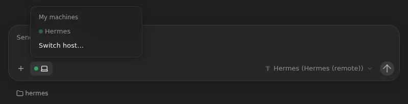

# Hermes answers without starting a sandbox

A session with the [hermes agent](hermes-remote.md) only passes your messages
on to your own Hermes, which works on its own machine. So instead of starting
a sandbox for each one, which took about 8 seconds, every Hermes session runs
on one always-on host: a Pod named `omnigent-hermes-host` that stays up. A new
Hermes session starts on it straight away.



## What you'll notice

- **A new Hermes session answers sooner.** No sandbox starts: the session's
  runner starts as soon as the session is created, and only the first turn's
  SSH connection to Hermes is left.
- **It works however you start the session:** from the web UI with
  **Agent Sandbox** picked, the glasses app or [Hermes's own Omnigent
  tools](omnigent-mcp.md). You don't pick anything. An automation with the
  hermes agent still gets a sandbox: nobody waits on it.
- **The session's host is Hermes.** The composer shows the host chip
  instead of the environment menu, and its menu says **Hermes**. There's no
  sandbox to stop or wake up.
- **The host pickers don't list it.** It runs nothing but Hermes sessions:
  Claude Code and Codex keep their sandboxes, an automation without a host of
  its own never picks it, and a request that names the Hermes host for
  another agent is refused.
- **When the host is down**, such as while it restarts after a deploy, a new
  Hermes session gets a sandbox, as before. Sessions already on the host
  can't answer until it's back.
- **Repositories are left out.** Hermes works on its own machine, so a
  repository picked for a Hermes session, or from its project, isn't cloned.

Only the person who signed it in can use the host: an Omnigent host belongs
to one user. Everyone else's Hermes sessions still get sandboxes.

## Set it up

It's on wherever [Hermes is set up](hermes-remote.md#set-it-up)
(`hermes_remote_ssh_host` in `environments/<name>.toml`), from the next
deploy. Then sign the host in as you, once:

```bash
mise run setup-hermes-host
```

It asks for your Omnigent username and password, signs in, and keeps only a
token that lets the host stay signed in, in the `omnigent-hermes-host`
Secret, which only the host's Pod gets. Your password isn't kept. The token
lasts `grant_max_lifetime_days` from signing in; run the task again before
then, or after changing your password. Running it again signs the old token
out, and restarts the host.

`mise run credential-status` shows whether the host is signed in. Until it
is, the Pod waits, and Hermes sessions get sandboxes.

## Turn it off

Set `hermes_host = false` in `environments/<name>.toml` and deploy, which
removes the Pod. Then remove its sign-in:

```bash
./scripts/kube delete secret omnigent-hermes-host -n omnigent-sandboxes
```

Sessions that ran on the host can't answer any more; start new ones, which
get sandboxes.

## How it works

The Pod runs the runner image, so it's set up like a runner Pod: root in its
own user namespace, and on your tailnet, through which it reaches the Hermes
machine. It counts toward the runners' quota, within the room that keeps
spare beyond `runner_max_concurrency` runners. Its start script (`images/runner/hermes-host.sh`) writes the
sign-in where `omnigent login` would, then runs `omnigent host`. The host
renews its access with the token when it connects, and whenever the access
runs out. The render gives the host a fixed id, the same in the Pod and in
the server's `OMNIGENT_HERMES_HOST_ID`, so a restarted Pod is the same host
and its sessions find it again.

The server patch `images/server/patches/0024-hermes-host.patch` calls
`images/server/omnigent_hermes_host.py` when a session is created. A
top-level session whose agent uses the `hermes-remote` harness, and that
would get a sandbox, starts on that host instead, if it's online and yours.
Each session gets its own runner process there, in the shared, empty
`/home/omnigent/hermes`. A runner idle for an hour exits, and the next
message starts it again. The same module keeps everything else off the
host: a create that names it for another agent is refused, and an automation
that picks a host itself skips it. It also marks the host `hermes_only` in the
host list, which the web UI patch
`images/server/web-patches/0040-hide-hermes-host.patch` leaves out of the host
pickers.

Whoever can sign in to the Pod, such as over Tailscale SSH, can use the
token as you. See the [threat model](../threat-model.md).
