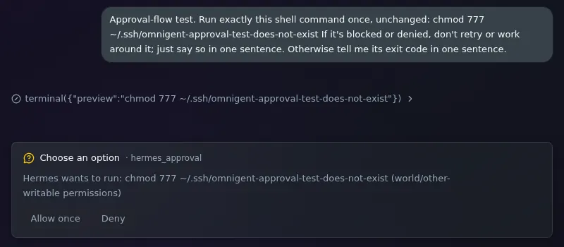

# Your own Hermes as an agent

Pick the **hermes** agent for a session and the session talks to your own
[Hermes Agent](https://hermes-agent.nousresearch.com/), on its own machine,
instead of starting an agent in the session's Pod. It's the same Hermes as in
its desktop app, terminal and chat platforms: each Omnigent session is a
session in that Hermes's history, with its memory, skills and model login.

Nothing about Omnigent runs on the Hermes machine. The session's Pod reaches
Hermes's API server over SSH, through your tailnet, with a key that may do
nothing else.

To go the other way, and give Hermes your Omnigent sessions as tools, see
[Omnigent as tools for your Hermes](omnigent-mcp.md).

## Set it up

### 1. Turn on Hermes's API server

On the Hermes machine, the gateway serves the API on `127.0.0.1:8642` once
its env file has a key. Put the settings in a file only the gateway service
reads, `~/.config/hermes/api-server.env`:

```bash
API_SERVER_ENABLED=true
API_SERVER_HOST=127.0.0.1
API_SERVER_PORT=8642
API_SERVER_KEY=<a long random string, such as from `openssl rand -hex 24`>
```

Load it into the gateway with a systemd drop-in,
`~/.config/systemd/user/hermes-gateway.service.d/api-server.conf`:

```ini
[Service]
EnvironmentFile=%h/.config/hermes/api-server.env
```

Then `systemctl --user daemon-reload && systemctl --user restart hermes-gateway`.

### 2. Run OpenSSH beside Tailscale SSH

If the Hermes machine uses Tailscale SSH, that answers port 22 on its tailnet
address and ignores SSH keys. Run OpenSSH on another port of that address for
the key, key-only, in `/etc/ssh/sshd_config.d/10-hermes-remote.conf`:

```text
Port 2222
ListenAddress <the machine's 100.x tailnet address>
AllowUsers <the user Hermes runs as>
PasswordAuthentication no
KbdInteractiveAuthentication no
PermitRootLogin no
AllowTcpForwarding local
AllowStreamLocalForwarding no
X11Forwarding no
```

sshd can only bind that address once tailscaled is up, so order it after
tailscaled in `/etc/systemd/system/ssh.service.d/10-after-tailscale.conf`:

```ini
[Unit]
After=tailscaled.service
Wants=tailscaled.service

[Service]
Restart=on-failure
RestartSec=5
```

Ubuntu starts sshd from `ssh.socket`, which ignores `ListenAddress`, so run it
as a service: `systemctl disable --now ssh.socket`, `systemctl daemon-reload`
and `systemctl enable --now ssh.service`.

Sessions reach port 2222 only if your
[tailnet policy](https://login.tailscale.com/admin/acls) lets
`tag:omnigent-runner` connect to the machine.

### 3. Store the key

```bash
mise run setup-hermes-ssh-key
```

It makes a key, stores it in the `omnigent-creds` Secret that runner Pods
receive, and prints a line like this. Add it to `~/.ssh/authorized_keys` of
the user Hermes runs as:

```text
restrict,port-forwarding,permitopen="127.0.0.1:8642",command="cat ~/.config/hermes/api-server.env" ssh-ed25519 AAAA... omnigent-hermes-remote
```

`command=` makes every login with the key print the API server's settings,
whatever it asked to run, and `permitopen=` lets it forward only to the API
server. Give the task a path to store an existing private key instead.

### 4. Point the deployment at it

In your `environments/<name>.toml`:

```toml
hermes_remote_ssh_host = "home-hermes.taild5bc1b.ts.net"
hermes_remote_ssh_user = "n3bby"
hermes_remote_ssh_port = 2222
```

Deploy. The new images carry the harness, and new runner Pods get the
settings.

### 5. Add the agent

Once, from your computer:

```bash
omnigent agent add packages/omnigent-hermes-remote/agents/hermes --server https://<your hostname>
```

The **hermes** agent then shows in the new-session picker on every device.

## What you'll see

- **In a session with the hermes agent**, Hermes's answer streams into the
  chat, and each command or tool it runs shows as a card with what it ran.
  **Stop** stops Hermes too.
- **In Hermes's desktop app and `hermes sessions`**, each Omnigent session is
  a session named `omnigent-<session id>`, with the title Hermes gives it.
  Continue it there, and the next Omnigent message picks up from there too.
- **When Hermes asks to approve a command**, the chat shows an approval card
  with the command and Hermes's own choices: **Allow once**, **Allow for this
  session**, **Always allow** and **Deny**, or only some of them, as Hermes
  offers. The session shows **Needs response** in the sidebar until you
  answer. Hermes gives up on the question after its approval timeout (5
  minutes by default), and its desktop app or terminal can answer it too;
  then the card goes away and the chat says Hermes stopped waiting. Commands
  Hermes's smart approvals allow or block on their own never reach you.

  
- **When it can't reach Hermes**, the turn fails with what went wrong, such as
  `SSH to n3bby@home-hermes.taild5bc1b.ts.net failed: Permission denied
  (publickey).`

## How it works

The hermes-remote harness is a Python package,
[`packages/omnigent-hermes-remote`](../../packages/omnigent-hermes-remote/README.md),
that both images install. The server needs it to accept the harness name and
list it, and runner Pods run it.

On a session's first turn, the harness reads the API server's port and key
over SSH, then forwards a Unix socket in the Pod to the API server and keeps
the tunnel for the session's later turns. Each turn is a run on Hermes's
`/v1/runs` API in the session's Hermes session, carrying only the new
message: Hermes loads the rest of the conversation from its own history.
Hermes picks its own model and keeps its own instructions (`SOUL.md`), so the
agent sets neither.

An approval Hermes asks for arrives as an `approval.request` event. The
harness shows it as an approval card, and while it waits it checks the run
every few seconds: once the run no longer lists the prompt, it takes the card
down. Your answer goes to `POST /v1/runs/{id}/approval` with the prompt's id.

The settings reach the harness as `HERMES_REMOTE_SSH_HOST`, `_USER`, `_PORT`
and `_KEY`. Omnigent's runner hands harnesses only the environment variables
it allows, so the render names them in `OMNIGENT_RUNNER_ENV_PASSTHROUGH`.

## Turn it off

Remove the three `hermes_remote_*` settings and deploy, and remove the agent
with `omnigent agent remove hermes`. Remove the key's line from
`authorized_keys` on the Hermes machine, and the key from the Secret with
`./scripts/kube patch secret omnigent-creds -n omnigent-sandboxes --type=json
-p '[{"op":"remove","path":"/data/HERMES_REMOTE_SSH_KEY"}]'`.
