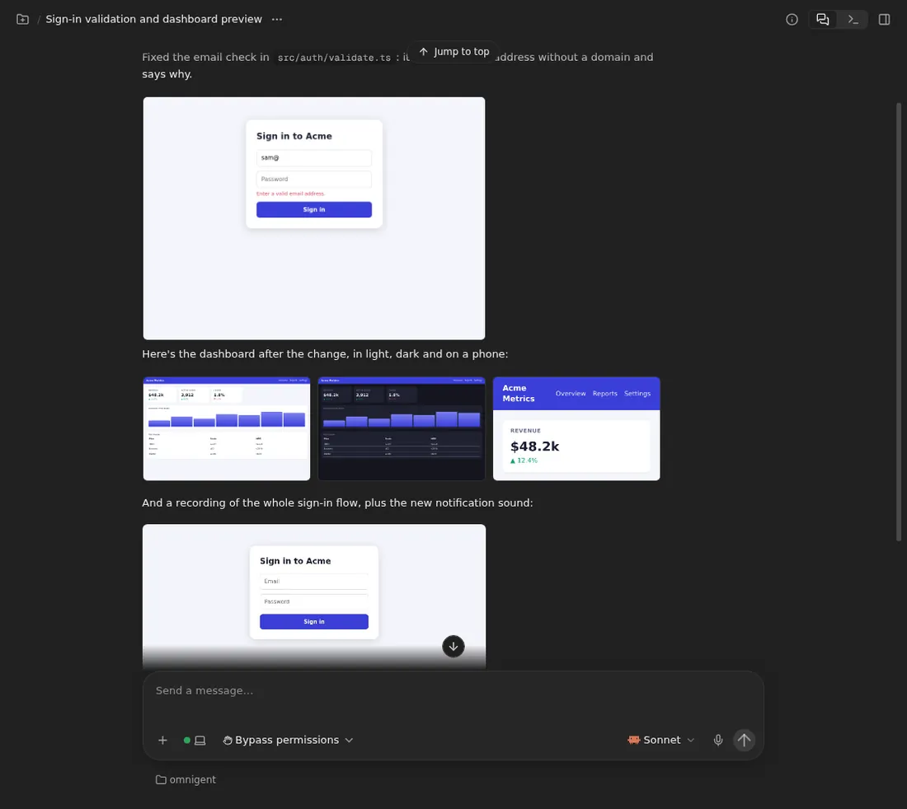
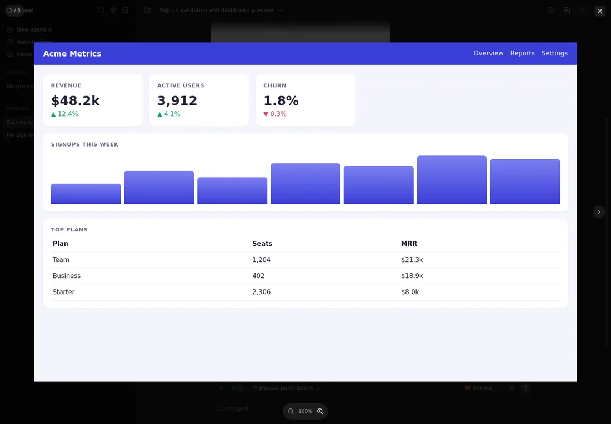
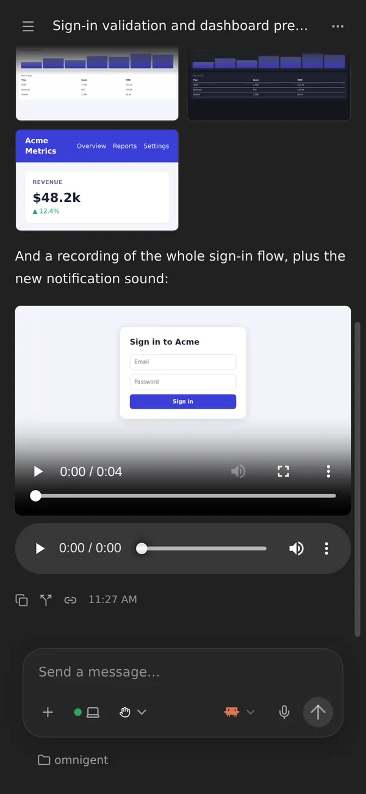
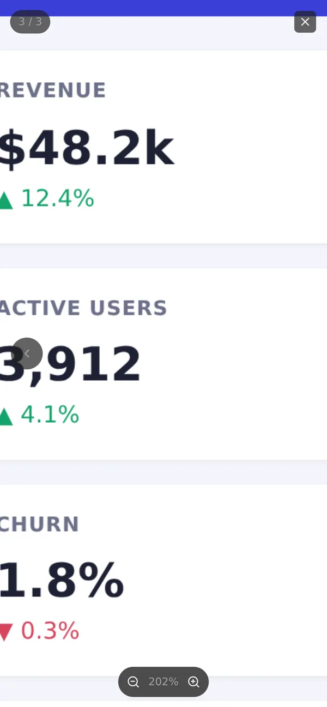

# Images, video and audio in the chat

When an agent puts an image in its reply, such as a screenshot it just took,
you see the image in the chat, not "[Image blocked]". Several images in a row
sit side by side in a grid. Click one to open it full screen, where you can
zoom in, with a pinch on a phone, and step to the next one. A video or audio
file plays in the chat.

## Using it

- **An image is markdown image syntax:** ``.
  The path can be absolute, relative to the workspace, or a `file://` URI.
  An `https://` URL or a `data:` image works too.
- **Images in a row become a grid.** Two or more images with nothing but
  spaces, line breaks or blank lines between them share one grid: up to
  three a row in the chat and two on a phone, with more wrapping onto further
  rows. Each tile shows the top of its image; open it to see all of it. A
  single image shows on its own, as wide as two tiles of a three-image grid
  at most, and up to 20rem high.
- **Click or tap an image** to open it full screen. Then:
  - **Zoom** with a two-finger pinch on a phone or tablet, a pinch on a
    trackpad, the scroll wheel, a double-click or double-tap, the **+** and
    **−** buttons, or the `+`, `-` and `0` keys. It zooms around the point
    you pinch or point at, up to 8×.
  - **Move around** a zoomed image by dragging it. It stops at the image's
    edges.
  - **Step through the grid** with the arrows at the sides, the arrow keys,
    or a swipe left or right. A counter shows where you are, such as
    `2 / 3`. The images you attach to your own message work the same way.
  - **Close it** with the × button, Escape, a click beside the image, or a
    swipe down.
- **Video and audio play in the chat.** `` gets a video
  player, and `` an audio player. Video: `.mp4`, `.m4v`,
  `.webm`, `.mov` and `.ogv`. Audio: `.mp3`, `.m4a`, `.aac`, `.wav`, `.ogg`,
  `.oga`, `.opus` and `.flac`. A player has its own line rather than a place
  in a grid, and is as wide as a single image.

## Good to know

- **Agents know to show images.** The [instructions agents get](runner-instructions.md)
  ask them to show a screenshot with `` rather than
  link it, and to put several in a row. Other files they still link with
  `[name](path)`, which opens them in the file viewer.
- **A file loads when its message is on screen,** through the session, so
  you only see files the session can read. If it can't be read, for example
  because the file is gone, you see a grey chip with its name instead.
- **A path shows the file as it is now.** If the agent overwrites
  `shot.png`, an older message that shows `shot.png` shows the new one after
  you reload.
- **A video is loaded whole before it plays,** because the file download
  doesn't support seeking into a file. That's fine for screen recordings; a
  very large video takes a while.
- **Plain `http://` images stay blocked**, as "[Image blocked: …]". An image
  loads in your browser, so an `http://` URL could make it send a request to
  a device on your own network, such as a router, which the sandbox can't
  reach. An `https://` request never reaches a device without a valid
  certificate. Images from `https://` sites load like any other: upstream
  blocks them too, so that an agent can't leak data in an image's URL, but
  agents here already reach the internet without asking.

## Turning it off

You can't.

## How it works

| Part | Patch | What it does |
| --- | --- | --- |
| Runner | `images/runner/agent-instructions.md` | Tells agents to show images with image syntax, several in a row for a grid |
| Web UI | `images/server/web-patches/0033-inline-media.patch` | Lets https and data images through Streamdown's sanitizer, loads a workspace path through the session's file download, plays video and audio, groups images in a row into a grid, and adds pinch zoom, double-tap, swipes and paging to the shared image viewer |

Upstream Omnigent sets Streamdown's `allowedImagePrefixes` to nothing, so
every markdown image became "[Image blocked: …]", and a workspace path
couldn't load anyway, because the browser can't reach the sandbox. The patch
moves a workspace path off the image's `src` before the sanitizer sees it,
and the chat loads the file as a Blob from the filesystem route with
`download=true`. That's the same route the file viewer's download uses, with
the same access checks, fetched the way the app fetches its other files, so
an embedding host's or the mobile app's own sign-in comes along. Streamdown
renders each markdown block on its own, so the patch keeps a run of
image-only paragraphs in one block for the grid to see. The full-screen viewer
is upstream's, which only zoomed with the wheel, buttons and a double-click;
the patch makes the image take touches itself (`touch-action: none`), so a
pinch zooms the image instead of the page.
