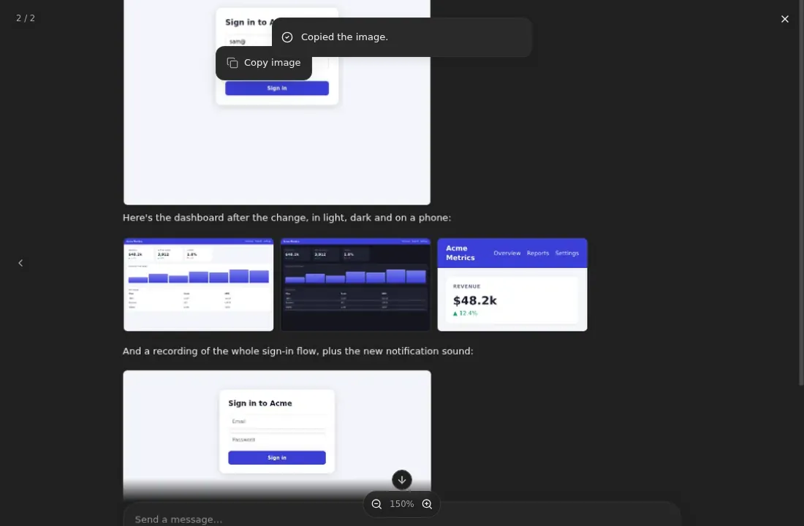
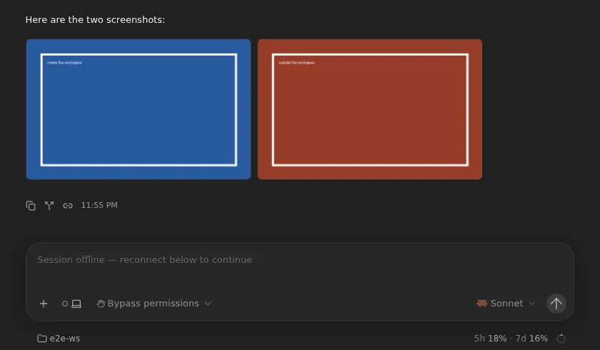

# Images, video and audio in the chat

When an agent puts an image in its reply, such as a screenshot it just took,
you see the image in the chat, not "[Image blocked]". It stays there after
the sandbox stops or the session is archived: the server keeps a copy. Several images in a row
sit side by side in a grid. Click one to open it full screen, where you can
zoom in, with a pinch on a phone, and step to the next one. In the desktop
app, right-click one to copy it. A video or audio file plays in the chat.

## Using it

- **An image is markdown image syntax:** ``.
  The path can be absolute, relative to the workspace, or a `file://` URI.
  An `https://` URL or a `data:` image works too.
- **Images in a row become a grid.** Two or more images with nothing but
  spaces, line breaks or blank lines between them share one grid: up to
  three a row in the chat and two on a phone, with more wrapping onto further
  rows. Each tile shows the top of its image; open it to see all of it. A
  single image shows on its own, as wide as two tiles of a three-image grid
  at most, and up to 20rem high.
- **Click or tap an image** to open it full screen. Then:
  - **Zoom** with a two-finger pinch on a phone or tablet, a pinch on a
    trackpad, the scroll wheel, a double-click or double-tap, the **+** and
    **−** buttons, or the `+`, `-` and `0` keys. It zooms around the point
    you pinch or point at, up to 8×.
  - **Move around** a zoomed image by dragging it. It stops at the image's
    edges.
  - **Step through the grid** with the arrows at the sides, the arrow keys,
    or a swipe left or right. A counter shows where you are, such as
    `2 / 3`. The images you attach to your own message work the same way.
  - **Close it** with the × button, Escape, a click beside the image, or a
    swipe down.
- **Right-click an image to copy it** in the desktop app, in the chat or
  open full screen, and choose **Copy image**. "Copied the image." confirms
  it, and you can paste it anywhere that takes an image, as a PNG. In a
  browser, the browser's own right-click menu has Copy image already, so
  you get that one.
- **Video and audio play in the chat.** `` gets a video
  player, and `` an audio player. Video: `.mp4`, `.m4v`,
  `.webm`, `.mov` and `.ogv`. Audio: `.mp3`, `.m4a`, `.aac`, `.wav`, `.ogg`,
  `.oga`, `.opus` and `.flac`. A player has its own line rather than a place
  in a grid, and is as wide as a single image.

## Good to know

- **Agents know to show images.** The [instructions agents get](runner-instructions.md)
  ask them to show a screenshot with `` rather than
  link it, and to put several in a row. Other files they still link with
  `[name](path)`, which opens them in the file viewer.
- **Images outlive the sandbox.** When a turn ends, the server keeps a copy
  of every file the agent's replies showed. While the sandbox runs, the chat
  loads the file from it; once the sandbox is asleep, stopped, or deleted
  with an archived session, or the agent deleted the file, the chat shows
  the copy. So you can scroll back through an archived session, or open a
  sleeping one on your phone, without starting its sandbox.
  A file the agent deletes in the same turn it showed it, before you opened
  the chat, is gone before the copy is taken.

  

- **Nothing flashes.** An image loads once per message: when the reply is
  saved after streaming, when you come back to the session, or when it
  scrolls back into view, it's there in the first frame, with no spinner and
  no second download. Only a message showing a file for the first time shows
  a spinner while it loads, and an image replaces it fully drawn. Nothing in
  the chat changes when the sandbox stops, or when the server takes its copy.
- **A path shows the newest version the server saw.** If the agent overwrites
  `shot.png` and shows it again, the new reply shows the new one, and the
  older reply keeps the one it showed until you reload. After a reload, every
  message showing `shot.png` shows the new one, from the sandbox or, once
  it's gone, from the copy, which follows the file whenever the chat loads it
  and at the end of a turn whose reply shows it again.
- **A file you can't see stays a chip.** You only see files the session can
  read, and one outside the workspace, such as `/tmp/shot.png`, only if the
  session is yours, as in the file viewer. If a file can't be loaded and has
  no copy, for example a reply from before this feature whose sandbox is
  gone, you see a grey chip with its name instead.
- **Copies take server disk and go with their session.** Each copy is in the
  server's artifact volume, under `chat-media/<session id>/`; deleting the
  session deletes them. Archiving keeps them. A file over 64 MiB, such as a
  long video, isn't kept: it plays while the sandbox runs and is a chip
  after.
- **A video is loaded whole before it plays,** because the file download
  doesn't support seeking into a file. That's fine for screen recordings; a
  very large video takes a while.
- **Copying an image from another site** works only when that site allows
  it (CORS); otherwise you see "Couldn't copy the image." Images from the
  workspace always copy. An animated GIF copies as its first frame.
- **Plain `http://` images stay blocked**, as "[Image blocked: …]". An image
  loads in your browser, so an `http://` URL could make it send a request to
  a device on your own network, such as a router, which the sandbox can't
  reach. An `https://` request never reaches a device without a valid
  certificate. Images from `https://` sites load like any other: upstream
  blocks them too, so that an agent can't leak data in an image's URL, but
  agents here already reach the internet without asking.

## Turning it off

You can't.

## How it works

| Part | Patch | What it does |
| --- | --- | --- |
| Runner | `images/runner/agent-instructions.md` | Tells agents to show images with image syntax, several in a row for a grid |
| Web UI | `images/server/web-patches/0033-inline-media.patch` | Lets https and data images through Streamdown's sanitizer, loads a workspace path through the session's file download, plays video and audio, groups images in a row into a grid, and adds pinch zoom, double-tap, swipes and paging to the shared image viewer, and keeps each message's files in memory, so a remount doesn't flash |
| Web UI | `images/server/web-patches/0034-copy-image.patch` | Adds a right-click menu with Copy image to images in the chat and the full-screen viewer, in the desktop app |
| Server | `images/server/patches/0027-chat-media-copies.patch`, `images/server/omnigent_chat_media.py`, `images/server/omnigent_chat_media_api.py` | Serves `GET /v1/sessions/{id}/chat-media`, from the sandbox or the server's copy; keeps copies at each turn's end; deletes them with their session |
| Web UI | `images/server/web-patches/0044-chat-media-copies.patch` | Loads a workspace path through that route instead of the filesystem route |

Upstream Omnigent sets Streamdown's `allowedImagePrefixes` to nothing, so
every markdown image became "[Image blocked: …]", and a workspace path
couldn't load anyway, because the browser can't reach the sandbox. The patch
moves a workspace path off the image's `src` before the sanitizer sees it,
and the chat loads the file as a Blob from the filesystem route with
`download=true`. That's the same route the file viewer's download uses, with
the same access checks, fetched the way the app fetches its other files, so
an embedding host's or the mobile app's own sign-in comes along. Streamdown
renders each markdown block on its own, so the patch keeps a run of
image-only paragraphs in one block for the grid to see. The full-screen viewer
is upstream's, which only zoomed with the wheel, buttons and a double-click;
the patch makes the image take touches itself (`touch-action: none`), so a
pinch zooms the image instead of the page.

The chat asks `GET /v1/sessions/{id}/chat-media?path=<path>` for a file,
with the path as the reply wrote it, and the server resolves it against the
workspace the way the web UI's file links do. While the sandbox can be
reached, the server streams the file from it through the filesystem route's
download, keeps the bytes in the artifact store as the copy of that path
(only rewriting them when they changed), and answers with them. When the
sandbox can't be reached, or no longer has the file, it answers with the
copy. The `X-Omnigent-Chat-Media` header says which: `live` or `copy`. Copies
are kept per session and per path, with an `index.json` naming them, and a
file outside the workspace is marked owner-only.

So that a reply's images are kept even if nobody opened the chat while the
sandbox ran, the server's status publisher tells `omnigent_chat_media` when a
session goes idle or fails. It then looks through the session's 40 newest
items for workspace paths in image syntax in the agent's replies, skipping
code blocks, URLs and `data:` images, and fetches each one whose copy is
older than the reply that shows it, at most 20 a turn. Since the server
resolves the path, an absolute path no longer waits for the sandbox's
environment metadata either, which a sleeping sandbox can't give.

The chat remounts a message's media more often than it looks: when a
streamed reply is saved, when you come back to a session, when a row of the
virtualized transcript scrolls back into view. Each mount used to download
the file again behind a spinner. Patch 0033 keeps the files in memory
(`web/src/lib/chatMediaCache.ts`): each message, by its bubble's stable key,
keeps the object URL of the version it first showed, so a remount paints it
at once. A message showing a path for the first time downloads it, which is
how an overwritten file reaches the new reply; mounts while a download is in
flight, or within a second after it, such as the transcript's first render,
share that one. Images are decoded before they replace their spinner. A file
that failed stays a chip and is tried again in the background after 10
seconds. Object URLs nothing shows are revoked past 300 files or 192 MiB.

The desktop app's window has no right-click menu of its own, so a
right-click on an image did nothing there. Patch 0034 adds one, only in the
desktop app, so a browser keeps its fuller native menu. It draws the image
on a canvas and puts it on the clipboard as a PNG, the one image type every
clipboard takes, so a WebP or JPEG copies too.
