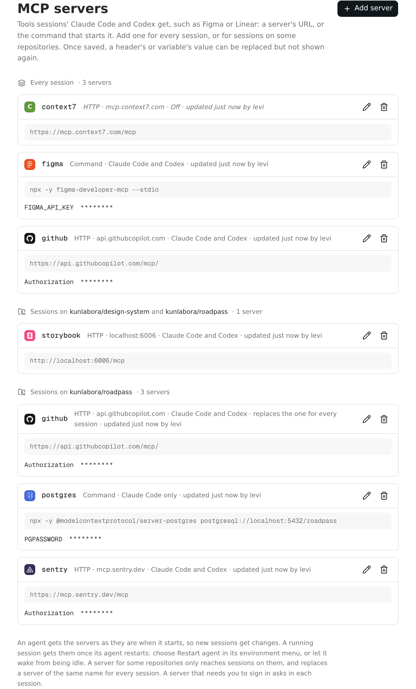
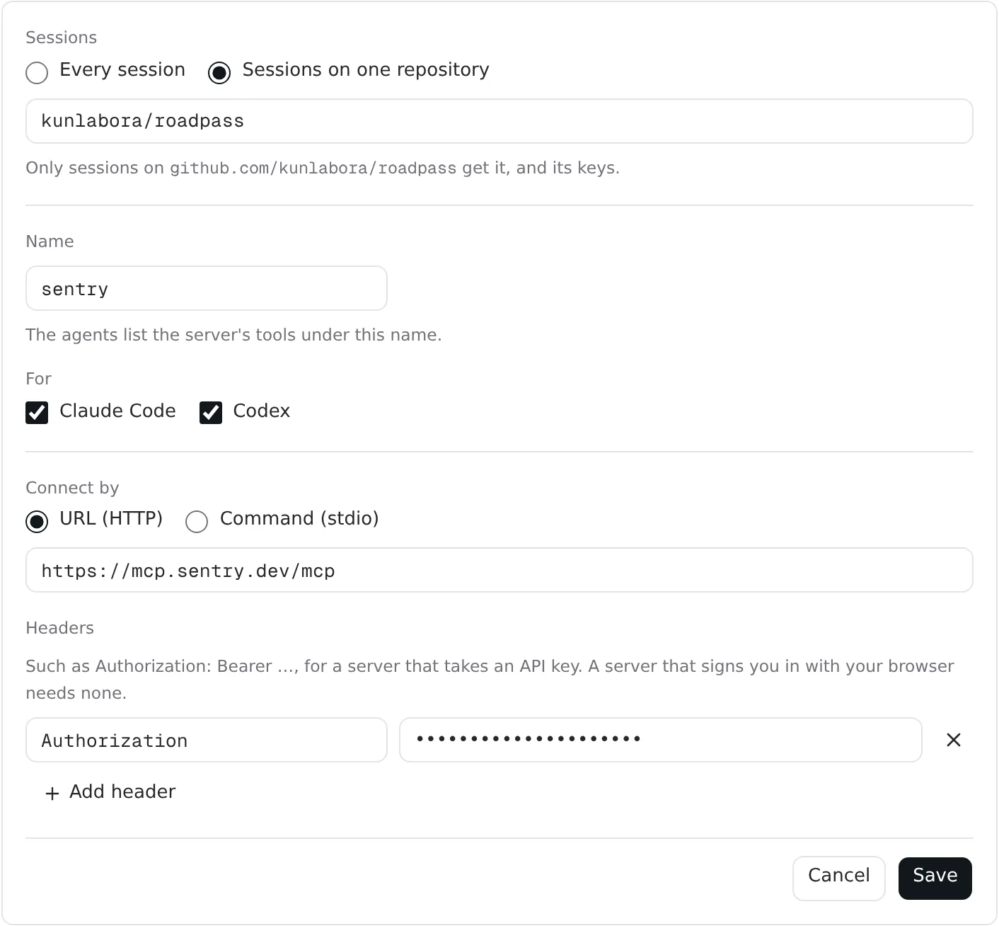

# MCP servers in Settings

Give sessions' Claude Code and Codex the MCP servers they need, such as Figma
or GitHub, with their keys: for every session, or for sessions on one
repository. Admins add them once in **Settings → MCP servers**. Switching a
server on or off needs no deploy.

Without this page, an MCP server you add in a session with `claude mcp add` or
`codex mcp add` only exists in that session: the next session starts in a new
Pod without it.

## Adding a server

1. In Omnigent, go to **Settings → MCP servers** (admins only) and choose
   **Add server**.
2. Under **Sessions**, choose **Every session**, or **Sessions on one
   repository** and the repository: pick it from the suggestions, or type
   `owner/repo` or paste a clone URL. See
   [a repository's servers](#a-repositorys-servers).
3. Give it a **Name**, such as `figma`. The agents list the server's tools
   under it. Use letters, digits, `-` and `_`; `omnigent` is taken by
   Omnigent's own server.
4. Under **For**, choose **Claude Code**, **Codex**, or both. With neither,
   the server is kept but switched off.
5. Under **Connect by**, choose one:
   - **URL (HTTP)**, for a server that runs somewhere else. Add the
     **Headers** it needs, such as `Authorization` with `Bearer <key>`.
   - **Command (stdio)**, for a server that runs in the session's Pod, such as
     `npx` with its package. Put **Arguments** one per line, and keys in
     **Variables**, not in the arguments.
6. **Save.**

The page lists the servers for every session first, then each repository's
under its name.

Like [repository variables](repo-env.md), a header's or variable's value only
goes from the browser to the server. The page shows its name and
`••••••••`, and editing with the field left blank keeps the value.

## A repository's servers

A server for one repository only reaches sessions that start with that
repository, like its [variables](repo-env.md), and so do its keys. Use it for
a server only that project needs, or to give one project a different key.

- **It replaces a server of the same name for every session.** With a
  `github` for every session and another `github` for roadpass, sessions on
  roadpass get roadpass's. The page says so on both sides. A repository's
  server switched off for an agent still keeps the other one from that agent.
- **With several repositories** that have a server of the same name, the
  session gets the one of the repository it started with first.
- **It's kept with the repository's variables.** Its card in
  [Repository variables](repo-env.md) counts its MCP servers, saving the
  variables keeps them, and removing the repository there removes them too.
  A repository with only MCP servers is listed there as well.
- **It stays where you added it.** To move a server to another repository or
  to every session, add it again there and remove it here.

A repository can also commit its own `.mcp.json` for Claude Code. Those work
too, alongside these, but anyone who can read the repository sees them, so
they can't hold a key.

## Figma

Figma has two MCP servers, and they sign in differently.

**With a personal access token**, every session works without signing in.
[Framelink's server](https://github.com/GLips/Figma-Context-MCP) is a
community project, not Figma's, that reads your files through Figma's API:

| Field | Value |
| --- | --- |
| Name | `figma` |
| Connect by | Command (stdio) |
| Command | `npx` |
| Arguments | `-y`, `figma-developer-mcp` and `--stdio`, one per line |
| Variables | `FIGMA_API_KEY`, with a token from Figma's **Settings → Security → Personal access tokens** |

**Figma's own server** is `https://mcp.figma.com/mcp`, with no headers. Figma
only lets you sign in through your browser, not with a token, so each session
asks you once. See [signing in](#signing-in-to-a-server).

## Other examples

GitHub's hosted server takes a token in a header:

| Field | Value |
| --- | --- |
| Name | `github` |
| Connect by | URL (HTTP) |
| URL | `https://api.githubcopilot.com/mcp/` |
| Headers | `Authorization`, with `Bearer <a fine-grained GitHub token>` |

A server packaged as a container runs with `docker`, which is Podman in the
Pod (see [root and containers](root-and-containers.md)). Pass its variables
into the container with `-e NAME`:

| Field | Value |
| --- | --- |
| Command | `docker` |
| Arguments | `run`, `-i`, `--rm`, `-e`, `GITHUB_PERSONAL_ACCESS_TOKEN` and `ghcr.io/github/github-mcp-server`, one per line |
| Variables | `GITHUB_PERSONAL_ACCESS_TOKEN` |

## What happens in a session

- **An agent gets the servers when it starts**: those for every session, and
  those of the repositories the session started with. A new session gets them
  straight away. A running session's agent keeps the servers it started
  with: choose **Restart agent** in its
  [environment menu](environment-menu.md), or let it wake from being
  [idle](idle-sessions.md). A change reaches running Pods within about a
  minute, once Kubernetes has synced it.
- **Claude Code** lists them in `/mcp`, next to the servers a repository's
  `.mcp.json` adds. **Codex** lists them in `codex mcp list`.
- **A command server starts in the Pod**, in the session's workspace, as root.
  Only that server gets its variables, not the agent. Arguments are taken as
  written: nothing in them, like `$HOME`, is expanded. The first start of an
  `npx` server downloads it; Codex waits up to 60 seconds for that.
- **A server that fails doesn't stop the agent.** The agent starts without
  it, and `/mcp` or `codex mcp list` says what went wrong.
- **Shells get them too.** `claude` and `codex` started over
  [SSH](tailscale.md) get the same servers.

## Signing in to a server

A server that signs you in with your browser, such as Figma's own, asks once
in each session. Do it over [SSH](tailscale.md), in the session's Pod:

- **Claude Code:** run `claude`, type `/mcp`, choose the server and
  **Authenticate**, then open the link it shows. After you approve, the
  browser tries to go back to `http://localhost:<port>/callback…` and can't,
  because that port is in the Pod. Copy that address from the browser's
  address bar and paste it at Claude's `URL >` prompt. Then choose
  **Restart agent** in the session's environment menu.
- **Codex:** run `codex mcp login <name>` with `CODEX_HOME` set to the
  session's Codex home, `~/.omnigent/codex-native/<id>/codex-home`, and open
  the link. When the browser can't load `http://127.0.0.1:<port>/callback…`,
  copy that address and load it in the Pod with `curl '<address>'` from a
  second SSH shell. Then choose **Restart agent**.

The sign-in stays in the session's home directory, so it lasts until you
delete the session.

## Good to know

- **Every session gets every server for every session.** Every runner Pod
  gets all of them, values included, whichever agents they're switched on
  for; a repository's only reach its sessions. Give each server a key with as
  little access as it allows. See the [threat model](../threat-model.md).
- **Only admins can see or change them.** Others don't see the page.
- **Runners from before this feature** need to be recreated once to get the
  servers. A sleeping session gets them when it wakes.
- **Omnigent's model probes don't start them**, so they don't slow down the
  model picker.
- **Up to 32 servers** for every session, and up to 32 per repository.

## Turning it off

Remove the servers, or switch one off by clearing both agents under **For**.
A repository's server switched off that way still keeps a global server of
the same name from its sessions, so remove it to give them the global one
again.
Agents then start exactly as they did before this feature.

## How it works

- **Storage:** the servers for every session are the `servers.json` key of
  the `omnigent-mcp-servers` Secret in `omnigent-sandboxes`
  (`images/server/omnigent_mcp_servers.py`). A repository's are the
  `mcp-servers.json` key of its [variables Secret](repo-env.md#how-it-works),
  which `omnigent_repo_env.py` keeps when the variables are saved and doesn't
  list as a variable. Saves replace a Secret only if nobody changed it since
  it was read; otherwise the page asks you to reload. Removing a repository's
  last server removes its Secret when nothing else is left in it.
- **The Settings page** (`images/server/web-patches/0028-mcp-servers.patch`)
  calls `/v1/mcp-servers`, which `images/server/omnigent_mcp_servers_api.py`
  serves (mounted by `images/server/patches/0019-mcp-servers.patch`). Every
  route is admin-only, and no response contains a header's or variable's
  value. The server's existing permissions on Secrets in `omnigent-sandboxes`
  cover it, so it needs no `mise run bootstrap`.
- **The Pod:** `0019-mcp-servers.patch` mounts the global Secret read-only at
  `/run/omnigent/mcp-servers/servers.json` in every runner Pod. The volume is
  optional, so Pods start as before when there's no Secret. A repository's
  servers come with its variables Secret, at
  `/run/omnigent/repo-env/<Secret>/mcp-servers.json`, which only its sessions
  mount (`images/server/patches/0004-repo-env.patch`).
- **The agents:** once one of those files exists, the `claude` and `codex`
  wrappers start their agent through `images/runner/mcp-servers.py`, which
  reads them each time. It merges them by name: a repository's first, in the
  order of `/run/omnigent-repo-setup/checkouts` (the session's repositories,
  first picked first), then the global ones. Then:
  - Claude Code gets `--mcp-config=/run/omnigent-mcp-servers/claude.json` in
    front of its arguments, which adds to Omnigent's own `--mcp-config`. An
    HTTP server's headers come from a `headersHelper` that runs
    `mcp-servers.py headers`. Omnigent's model probe, which passes
    `--strict-mcp-config`, gets nothing.
  - Codex gets `-c mcp_servers.<name>.…` overrides, only in a session's own
    `CODEX_HOME` and in `/opt/codex-home`, never in Omnigent's model probes.
    An HTTP server's headers are `env_http_headers`, read from
    `OMNIGENT_MCP_SECRET_<n>` variables that only this Codex process gets.
  - A command server starts as `mcp-servers.py run`, which adds its variables
    and runs the command, for both agents.

  So neither the config file nor any command line holds a value. If the file
  can't be read, the agent starts without the servers and says so on stderr.
- **Sign-ins:** Claude Code keeps them in `~/.claude/.credentials.json`.
  `images/runner/codex-config.toml` sets `mcp_oauth_credentials_store =
  "file"`, so Codex keeps them in the session's `CODEX_HOME`, not in a
  keyring the Pod doesn't keep.
