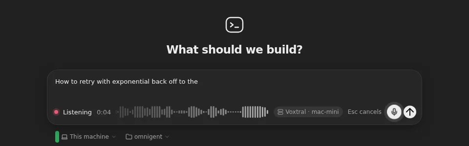
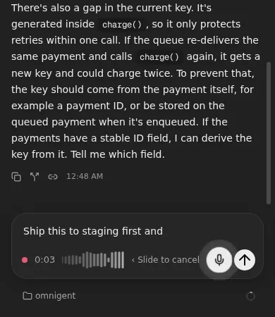
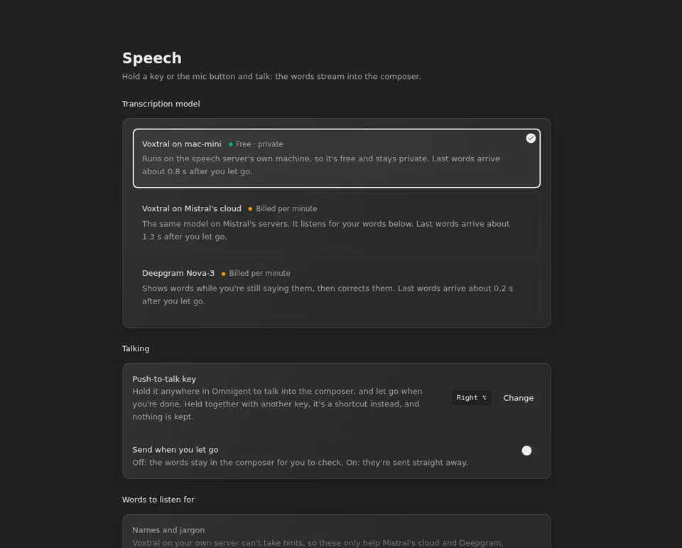

# Push-to-talk

Hold a key, or the mic button next to Send, and talk: your words stream into
the composer as you say them. Let go, and the last words land a moment
later. The speech is recognized by your own speech server, a Voxtral
Realtime server on your tailnet (such as a Mac mini), which can also pass
your voice on to Mistral's or Deepgram's cloud.



## What you'll notice

- **A mic button** between the model picker and Send, in a session's
  composer and on the New session screen.
- **Hold Right ⌥ anywhere**, or hold the mic button, and talk. You can
  choose another key in **Settings → Speech**.
- **While you talk**, the composer's tools give way to a red dot, the time,
  a waveform that follows your voice, which model is listening, and how to
  cancel. The mic button turns solid, with a soft halo that grows when
  you're loud. The words appear at the caret and fade in as they arrive.
  Once they fill the composer, it scrolls to keep the newest ones in view.
- **Let go**, and the bar says **Finishing** while the last words arrive:
  about 0.8 seconds later with Voxtral on your server. The text stays in the
  composer for you to check and send, or goes straight out if you turn on
  **Send when you let go**.
- **Esc cancels**, and puts the draft back as it was. On a phone, slide
  your finger off the button to the left.
- **A quick tap does nothing** but remind you to hold the button.



## Settings → Speech



| Setting | What it does |
| --- | --- |
| **Transcription model** | **Voxtral on your server** runs on the speech server's own machine: free and private. **Voxtral on Mistral's cloud** is the same model on Mistral's servers. **Deepgram Nova-3** shows words while you're still saying them, dimmed, and corrects them. The two cloud ones are billed per minute of audio. |
| **Push-to-talk key** | The key you hold. **Change**, then press the key you want; Esc keeps the old one. Held together with another key, it's a shortcut instead, and the take is dropped. |
| **Send when you let go** | Off: the words stay in the composer. On: they're sent straight away. |
| **Words to listen for** | Names and jargon the cloud models should expect, such as `Omnigent` or `k3s`. Voxtral on your own server can't use them. |
| **Speech server** | Where your voice goes, and whether this device can reach it. |

These are saved in the browser, so set them once on each device. They're part
of **Export settings**.

## Nothing streams once you let go

The microphone and the connection to the speech server only open while you
hold the key or the button, and close when the take ends. A take ends when
you let go, and also:

- when Omnigent's window loses focus or its tab is hidden, since the key
  being let go would never reach it;
- after 2 minutes;
- when you press Esc, or slide off the button.

The speech server enforces the same 2 minutes, and ends a take that sends no
audio for 30 seconds, so a stuck browser can't keep streaming to Mistral or
Deepgram either.

## Setting it up

1. Run a Voxtral Realtime speech server on a machine on your tailnet, behind
   `tailscale serve` so it has HTTPS. The one this was built with streams
   16 kHz PCM over `wss://<machine>/stream` and is described in its own
   `API.md`.
2. Set its address in the environment file and deploy:

   ```toml
   push_to_talk_url = "wss://mac-mini.taild5bc1b.ts.net:8443"
   ```

3. Open Omnigent on a device that's on the tailnet. The first time you talk,
   the browser asks to use the microphone.

## Good to know

- **Your browser talks to the speech server directly.** Omnigent's own
  server never sees the audio, so every device you dictate from must be on
  the tailnet. **Settings → Speech** says **Can't reach it from this
  device** when it isn't.
- **One person at a time** can use Voxtral on your server; someone else
  talking at the same time gets "Someone else is already using this Mac's
  model."
- **Both composers have it:** a session's and the New session screen's. The
  side chat doesn't.
- **The composer is read-only while you talk**, so typing can't get mixed
  into the dictated words.
- **The microphone needs HTTPS**, which the deployment always has.

## Turning it off

Remove `push_to_talk_url` from the environment file and deploy: the mic
button goes away. **Settings → Speech** then says how to turn it back on.

## How it's built

- **The server:** `images/server/patches/0025-push-to-talk.patch` reads
  `OMNIGENT_PUSH_TO_TALK_URL`, which `scripts/render` sets from
  `push_to_talk_url`, and `GET /v1/info` passes it on as `push_to_talk_url`.
- **The web UI:** `images/server/web-patches/0040-push-to-talk.patch`:
  - `web/src/lib/pushToTalk.ts` opens the microphone and the socket
    together, converts the audio to 16 kHz PCM in an AudioWorklet, holds
    what's recorded until the server is ready, sends `stop` when you let go,
    and closes after the last words (or 10 seconds). It also keeps the
    settings.
  - `web/src/hooks/usePushToTalk.ts` runs a take in a composer: the key,
    Esc, the 2-minute limit, focus loss, and the draft, which it rebuilds on
    every update from what it was when you started, so only its own words
    ever change.
  - `web/src/components/PushToTalk.tsx` has the mic button, the listening
    bar with its waveform, and the words, which the composer's highlight
    backdrop draws so each can fade in. `web/src/pushToTalk.css` styles them.
  - `web/src/components/PushToTalkSettings.tsx` is **Settings → Speech**.
