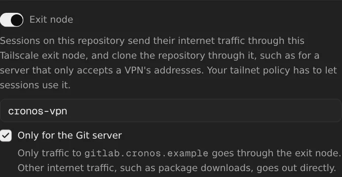
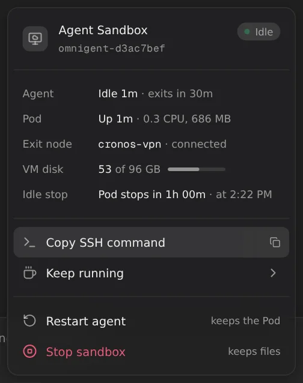

# A repository's exit node

Sessions on a repository can send their internet traffic through one of your
tailnet's exit nodes. Take a GitLab that only accepts a VPN's addresses: give
the repository the exit node that's connected to that VPN, and its sessions
clone, fetch and push through it.

When the VPN is slow, send only the traffic to the Git server through it:
package downloads, Docker pulls and the agent's own connection then go out
directly.

## Set it up

### 1. Put sessions on your tailnet

Follow [sessions on your tailnet](tailscale.md), including
`mise run bootstrap`, which gives runner Pods the TUN device the exit node
needs.

### 2. Let sessions use the exit node

The machine has to offer to be an exit node, and be approved as one in the
[admin console](https://login.tailscale.com/admin/machines). Then let
sessions use it, in your [tailnet policy](https://login.tailscale.com/admin/acls):

```json
"grants": [
  {"src": ["tag:omnigent-runner"], "dst": ["autogroup:internet"], "ip": ["*"]}
]
```

To allow only some exit nodes, give them a tag and add
`"via": ["tag:cronos-exit"]`. `via` takes tags, not machine names.

To check, run `tailscale exit-node list` in a session. The exit node should be
in the list.

### 3. Give the repository its exit node

In **Settings → Repository variables**, add or edit the repository, switch on
**Exit node**, and type the exit node's machine name, such as `cronos-vpn`.
Its MagicDNS name or Tailscale IP works too.

To send only the traffic to the Git server through it, the host of the
repository's URL, also check **Only for the Git server**. Then **Save**.



## What you'll see

- **In Settings**, the repository's card lists `Exit node cronos-vpn`, with
  `· Git server only` when only the Git server uses it.
- **In the new-session form**, the repository's badge has an exit node
  entry: "Internet traffic and the clone go through cronos-vpn on your
  tailnet." With **Only for the Git server**: "Traffic to
  gitlab.cronos.example and the clone go through cronos-vpn on your tailnet.
  Other internet traffic goes out directly."
- **On the startup card**, the clone's log says
  `cloning through exit node cronos-vpn`, and the Tailscale line ends with
  `through exit node cronos-vpn`, or
  `through exit node cronos-vpn for gitlab.cronos.example`.
- **In the composer's [environment menu](environment-menu.md)**, the
  **Exit node** row says whether it's online: `cronos-vpn · connected`, or in
  red `cronos-vpn · offline`, when the session has no internet. When the
  session's repositories name different ones, it says so in amber.

  

- **In the session**, `tailscale status` marks `cronos-vpn` as the exit node,
  and `curl https://ifconfig.me` shows the exit node's address. With
  **Only for the Git server**, it shows the cluster's own address, and
  `ip rule` lists the Git server's addresses at priority 5261.

## Good to know

- **All the session's internet traffic goes through it:** the agent's own
  connection to Claude or OpenAI, package downloads and Docker pulls too.
  Only the cluster's own addresses don't, such as the Omnigent server and
  the cluster's DNS. Unless it's **only for the Git server**.
- **If the exit node is offline, the session has no internet,** so the agent
  can't reach Claude or OpenAI either. The environment menu shows it in red. A new session on the repository fails
  at its clone, and says the exit node is offline. Only for the Git server,
  only the Git server is out of reach.
- **Only for the Git server goes by address.** The session looks up the
  Git server's addresses through the cluster's DNS when it starts, and again
  every 5 minutes. Another
  host behind the same VPN, such as a registry with a name of its own, still
  goes out directly. To add it for a session, add it to
  `/run/omnigent-tailscale.exit-node-hosts` and run
  `omnigent-exit-node-routes`, or ask the agent to.
  Over IPv6, which the Pod has no route of its own for, it reaches only the
  Git server.
- **Only for the Git server needs the TUN device.** Without it, only what
  goes through the proxy on `localhost:1055` uses the exit node anyway, so
  the setting changes nothing.
- **Names still resolve through the cluster's DNS.** A Git server whose name
  only resolves inside the VPN can be cloned, but the session can't resolve
  the name afterwards. Use its public name or its address.
- **A session on several repositories** uses an exit node only if they name
  the same one. When they name different ones, it uses none, and the startup
  card says so. It's only for their Git servers when every one of them says
  so.
- **Changes reach new sessions.** A running session gets them after it has
  been [idle](idle-sessions.md) and wakes up.
- **The clone takes a few seconds longer.** It joins your tailnet as a
  temporary machine, `omnigent-clone`, which logs out when the clone is done.
- **Without the TUN device**, such as before `mise run bootstrap`, the clone
  still goes through the exit node. In the session, only the proxy on
  `localhost:1055` uses it.
- **An exit node isn't a security boundary.** The agent is root in its Pod:
  it can switch the session to any exit node your policy lets sessions use,
  or to none. Anyone signed in can see a repository's exit node in the
  new-session form, and only admins can set it. See the
  [threat model](../threat-model.md#runners-on-your-tailnet).

## Turning it off

Edit the repository in Settings → Repository variables and switch off
**Exit node**. A repository without one works as before. To send all the
session's traffic through it again, uncheck **Only for the Git server**.

## How it works

- **Where it's kept:** the `tailscale-exit-node` key of the repository's
  [Secret](repo-env.md#how-it-works) (`EXIT_NODE_KEY` in
  `images/server/omnigent_repo_env.py`). It isn't a variable name, so the
  agent wrappers don't export it. It isn't secret either: the Settings page
  reads it back, and `GET /v1/repo-env/names` returns it for the new-session
  form. `check_exit_node` only allows a machine's name or address.
  **Only for the Git server** is the `tailscale-exit-node-git-only` key
  (`EXIT_NODE_GIT_ONLY_KEY`), `"true"` or missing, which goes with the exit
  node: `PUT /v1/repo-env` takes `exit_node_git_only`, and a page that
  doesn't send it keeps it.
- **The page:** `images/server/web-patches/0036-repo-exit-node.patch` adds the
  switch to Settings → Repository variables, and the entry to the
  repository's badge. `PUT /v1/repo-env` takes `exit_node`; a page that
  doesn't send it keeps the one the repository has.
- **The clone:** `clone_command` in `images/server/omnigent_repo_env.py`
  wraps the repository's clone in a shell function. When the mounted
  `tailscale-exit-node` file has a name, the function runs the clone through
  `omnigent-via-exit-node` (`images/runner/tailscale/via-exit-node.sh`):
  - The `workspace-prep` init container has no TUN device and no
    capabilities, and the Pod's own node only joins once the host container
    starts. So it starts a `tailscaled` with userspace networking and its
    state in memory, joins as an ephemeral `omnigent-clone`, sets the exit
    node, and waits until it's online.
  - Git gets the node's SOCKS5 proxy as `http.proxy`, through
    `GIT_CONFIG_COUNT`, and an `ssh` first on its `PATH` that connects with
    `ProxyCommand=tailscale nc`. That covers a repository's
    [SSH key](custom-repository.md#how-it-works) too, which calls `ssh` by
    name. Only Git gets the proxy: the GitHub App's credential helper talks
    to the Omnigent server, which isn't on the tailnet.
  - The node logs out when the clone ends.
- **The session:** `images/runner/tailscale/tailscale-service.sh` reads
  `/run/omnigent/repo-env/*/tailscale-exit-node` after joining, and runs
  `tailscale set --exit-node=<name> --exit-node-allow-lan-access`. Its rules
  for the cluster's ranges keep the Omnigent server and the cluster's DNS off
  the exit node; see [how Tailscale works in a session](tailscale.md#how-it-works).
  It reports the exit node, or why it couldn't use it, on the startup card's
  Tailscale line, and writes the same to
  `/run/omnigent-tailscale.exit-node.json` for the environment menu.
- **Only for the Git server:** when every repository naming the exit node
  has `tailscale-exit-node-git-only` and the Pod has the TUN device,
  `tailscale-service.sh` writes their hosts, from the keys in
  `OMNIGENT_REPO_CHECKOUTS`, to `/run/omnigent-tailscale.exit-node-hosts`,
  and runs `omnigent-exit-node-routes`
  (`images/runner/tailscale/exit-node-routes.sh`) before it sets the exit
  node. Tailscale routes everything through the exit node with a default
  route in table 52, which its rule at priority 5270 looks up. Rules before
  it, for IPv4 and IPv6, look up:
  - 5260: table 52 without its default route, so tailnet machines and
    subnet routes still go through Tailscale.
  - 5261: table 52 for each of the hosts' addresses, so the exit node.
  - 5262: the main table, so everything else goes out directly.
  - 5263: nothing (`unreachable`), so IPv6 to the internet, which the Pod
    has no route of its own for, doesn't fall through to the exit node.

  Without an exit node, such as after the agent switched it off, table 52 has
  no default route, and the hosts' addresses go out directly too.
  `omnigent-exit-node-routes --keep` looks the hosts up again every 5
  minutes, or every 30 seconds while one doesn't resolve, and only replaces
  addresses once all of them resolve.
- **The page:** `images/server/web-patches/0038-repo-exit-node-git-only.patch`
  adds the **Only for the Git server** checkbox, the card's
  `· Git server only` and the badge's text.
- **The environment menu:** the runner's report every 5 seconds carries the
  exit node (`images/runner/patches/0012-environment-exit-node.patch`). It
  reads that file, and asks tailscaled's LocalAPI over its socket whether the
  exit node is online, without starting a process. The server keeps it with
  the rest of the report (`images/server/patches/0021-environment-exit-node.patch`),
  and the menu shows the **Exit node** row
  (`images/server/web-patches/0037-environment-exit-node.patch`): connected,
  offline, refused by Tailscale, not in use (such as after the agent switched
  it off), or different ones named. A session whose repositories name none has
  no row.
