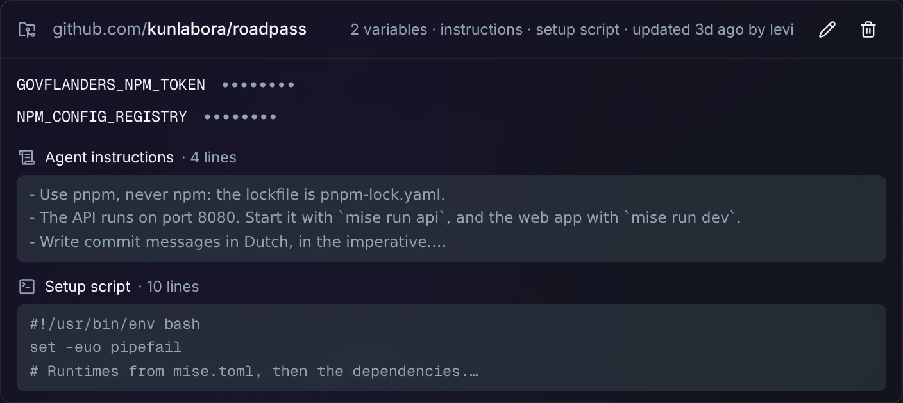
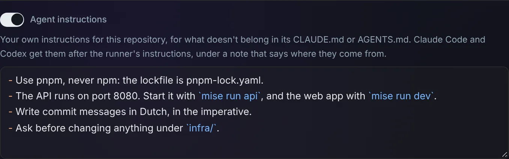
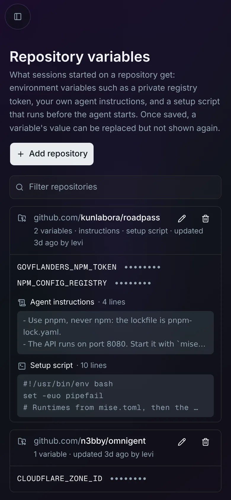
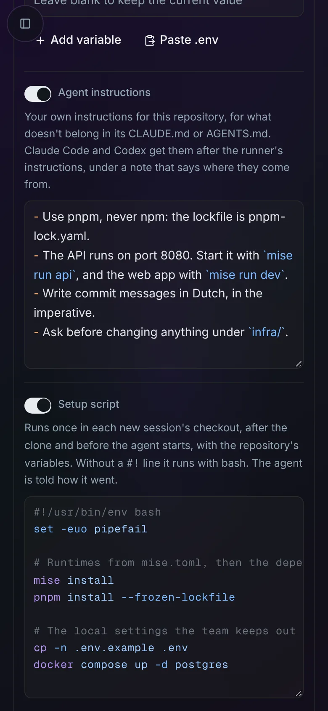

# A repository's own agent instructions

Give a repository extra instructions for its agents, such as which package
manager to use or which ports its services run on. They're for what doesn't
belong in the repository's `CLAUDE.md` or `AGENTS.md`, like your own habits
that you don't want to commit for the whole team. Claude Code and Codex
sessions started on that repository get them after the
[runner's own instructions](runner-instructions.md).



## Set it up

1. In Omnigent, go to **Settings → Repository variables** (admins only).
   Edit the repository with its pencil button, or **Add repository**.
2. Turn on **Agent instructions** and write them. Markdown is fine, and the
   field highlights it as you type.
3. **Save.**



Unlike a variable's value, the instructions come back when you edit them, so
you can change them in place. Turning the switch off and saving removes them.

The card then lists **instructions** in its summary, with their first lines.
New sessions on the repository get them.

The page works on a phone too. There, the card's summary wraps under the
repository, and each field takes the full width. A setup script's long lines
scroll sideways instead of wrapping, so each line stays one line.

<p>
  
  
</p>

## What the agent sees

The agent reads the runner's instructions first. After them, Omnigent appends
a section that says where the rest comes from, and then each repository's
instructions under its name:

```markdown
# Repository settings from Omnigent

Omnigent appended this to the runner's instructions, from what the user saved
for this session's repositories in Omnigent's Settings, under Repository
variables. It isn't in the repositories, so don't copy it into a repository
or commit it.

## github.com/kunlabora/roadpass

Checked out at `/home/omnigent/workspace/roadpass`.

### Instructions

These are the user's own instructions for this repository. Where they
disagree with the runner's instructions above or with the repository's own,
follow these.

- Use pnpm, never npm: the lockfile is pnpm-lock.yaml.
- The API runs on port 8080. Start it with `mise run api`, and the web app
  with `mise run dev`.
- Write commit messages in Dutch, in the imperative.
- Ask before changing anything under `infra/`.
```

A repository with a [setup script](repo-setup-script.md) also gets a
**Setup script** part there, which says how the script went.

To check what an agent got, ask it, or read the file yourself in the session:
`/etc/claude-code/CLAUDE.md` for Claude Code, `/opt/codex-home/AGENTS.md` for
Codex.

## Good to know

- **They're in the same place as the variables.** The page, the card and the
  remove button handle them with the repository's variables. Removing the
  repository removes its instructions too.
- **Anyone who starts a session on the repository gets them**, like its
  variables. They belong to the repository on this deployment, not to a user.
  Only admins can read or change them; others only see, in the new-session
  form, that the repository has instructions.
- **Keep them short.** Agents read them at the start of every session, so
  they cost context every time. The page refuses more than 64 KB.
- **The repository's own `CLAUDE.md` or `AGENTS.md` still applies.** The
  agent is told to follow yours where the two disagree.
- **Changes reach new sessions**, and a running session's agent the next time
  it starts, for example after the session has been [idle](idle-sessions.md).
- **Only the repositories a session starts with count**, as with variables.

## Turning it off

There's nothing to turn off. A repository without instructions gives its
agents the runner's instructions as before.

## How it works

- **Where they're stored:** the instructions are the key
  `agent-instructions.md` in the repository's
  [variables Secret](repo-env.md#how-it-works). A variable name can't contain
  a dot, so the key never clashes with a variable, and the variable loader
  skips it. `images/server/omnigent_repo_env.py` saves and lists it, and the
  page (`images/server/web-patches/0015-repo-instructions-setup.patch`)
  edits it through `/v1/repo-env`, whose `instructions` field is the whole
  text, or `null` to remove it.
- **The highlighting:** the field is a native textarea with transparent text,
  over a copy of the text that Shiki highlights, in the same font and
  wrapping, scrolling with it (`HighlightedTextarea` in the same web patch).
  Typing, selecting and phone keyboards work as in any textarea. Shiki is
  already in the web UI for the chat's code blocks, and loads only when an
  editor opens; until then the copy is plain text.
- **Where the checkout is:** the server sets `OMNIGENT_REPO_CHECKOUTS` on
  the runner Pod's host container
  (`images/server/patches/0012-repo-checkouts.patch`), one line per
  repository: its Secret, the repository and its checkout. At Pod start,
  `/etc/profile.d/omnigent-repo-setup.sh`
  (`images/runner/repo-env/repo-setup-profile.sh`) writes that list to
  `/run/omnigent-repo-setup/checkouts`, before the Omnigent host starts.
- **Appending them:** the `claude` and `codex` wrappers source
  `images/runner/repo-env/agent-instructions.sh` and rewrite their agent's
  file before starting it: `/etc/claude-code/CLAUDE.md` for Claude Code, and
  `/opt/codex-home/AGENTS.md`, which Omnigent links into each Codex session's
  home. Each is the image's untouched copy,
  `/usr/local/share/omnigent/agent-instructions.md`, plus the section above.
  The file is replaced atomically, and only when it changes, because several
  agents may start at once. If it can't be written, the agent starts with the
  runner's instructions alone.
