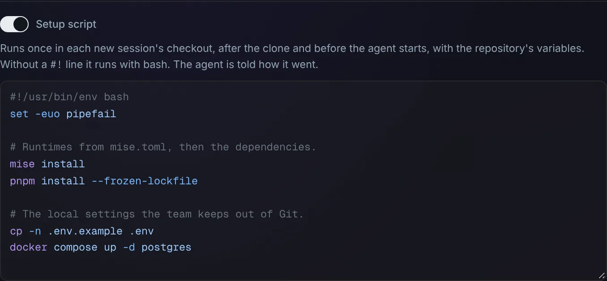
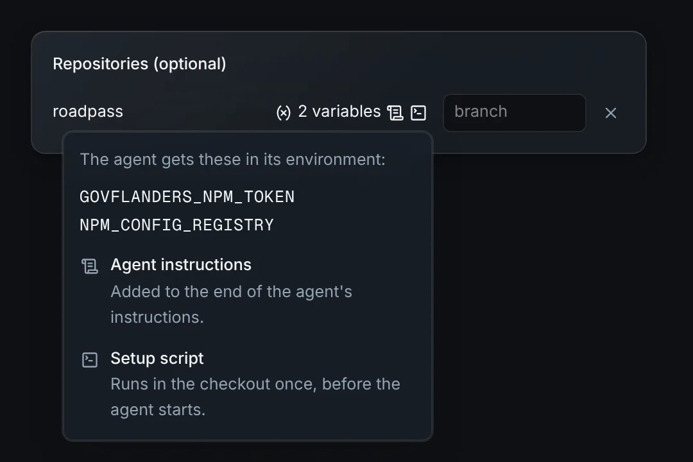

# A repository's setup script

Give a repository a script that sets up every new session on it: install its
runtimes and dependencies, copy a local config file into place, start a
database. It runs in the checkout after the clone, before the agent starts,
so the agent begins in a project that's ready to build.

## Set it up

1. In Omnigent, go to **Settings → Repository variables** (admins only).
   Edit the repository with its pencil button, or **Add repository**.
2. Turn on **Setup script** and write it. The field highlights it as shell,
   or as the language its `#!` line names, such as Python or Node.
3. **Save.**



Like the [agent instructions](repo-instructions.md), the script comes back
when you edit it. Turning the switch off and saving removes it. The card lists
**setup script** in its summary, with its first lines.

In the new-session form, a repository with a setup script shows a terminal
icon next to its variables. Clicking it says what the repository's sessions
get:



## Examples

A Node project that pins its runtimes in `mise.toml`, with a database for its
tests:

```bash
#!/usr/bin/env bash
set -euo pipefail

# Runtimes from mise.toml, then the dependencies.
mise install
pnpm install --frozen-lockfile

# The local settings the team keeps out of Git.
cp -n .env.example .env
docker compose up -d postgres
```

A script without a `#!` line runs with bash, so a short one can be just the
commands:

```bash
mise install
uv sync
```

Any interpreter works with its `#!` line, here Python:

```python
#!/usr/bin/env python3
import pathlib

pathlib.Path(".env").write_text("API_URL=http://localhost:8080\n")
```

A pre-commit hook that every session should have:

```bash
set -e
pip install --user pre-commit
pre-commit install
```

## What happens in a session

1. The Pod starts, and Omnigent clones the repository.
2. The script starts in the checkout, such as
   `/home/omnigent/workspace/roadpass`, as root, with the same environment an
   agent's shell gets: the repository's [variables](repo-env.md), and the
   tools from [mise](mise-runtimes.md). It doesn't get your input, and its
   output goes to a log, not to the chat. While the sandbox starts, the
   session's [startup card](startup-progress.md) shows the script running,
   and its **Log** shows the output as it comes.
3. The agent waits for it for up to 45 seconds. A script that takes longer
   keeps running beside the agent.
4. The startup card says when it finished. When it failed, the card says so
   with the script's last lines, and stays until you dismiss it.
5. The agent is told how it went, in its
   [instructions](repo-instructions.md#what-the-agent-sees):

   - **finished:** where its output is.
   - **failed:** its exit status and where its output is, and to tell you when
     that matters for what you ask.
   - **still running:** that what it sets up may not be ready yet, and which
     file gets its exit status when it finishes.

Its output and exit status are in
`~/.local/state/omnigent-repo-setup/<checkout>.log` and `.exit`, such as
`roadpass.log`, so you can read them too. For the first example, the log
looks something like this:

```text
# omnigent-repo-setup: the setup script of github.com/kunlabora/roadpass, in /home/omnigent/workspace/roadpass, 2026-10-11T20:52:33Z
mise all runtimes are installed
Lockfile is up to date, resolution step is skipped
Packages: +912
Done in 41.2s
# omnigent-repo-setup: exit status 0, 2026-10-11T20:53:16Z
```

## Good to know

- **It runs once per session.** It doesn't run again when an
  [idle](idle-sessions.md) session wakes, because its `.exit` file is in the
  home directory, which survives. So what it puts in the home directory,
  like mise runtimes, `node_modules` and the checkout's files, stays. What
  doesn't survive a wake, like `apt-get` packages, running containers and
  background processes, is gone after one; the agent can start those again.
- **A script that never finished runs again.** If the Pod stopped while it
  ran, the next Pod start runs it from the beginning.
- **Write it so it can run on a fresh checkout.** It always starts on a new
  clone, in the repository's root, on the branch you picked.
- **Add `set -e`** (or `set -euo pipefail`) to stop at the first failing
  command. Without it, a bash script carries on, and its exit status is that
  of its last command.
- **Long scripts overlap the agent.** Omnigent gives an agent about a minute
  to start, so the wait stops at 45 seconds. The agent knows when the script
  is still running, and you can see it in the log.
- **Docker is ready when it runs.** The script waits up to 15 seconds for
  the Podman service, which starts at the same time.
- **Only the repositories a session starts with count**, as with variables.
  With several, their scripts run one after another, in the order you picked
  them.
- **Changes reach new sessions.** A session that has already run the script
  doesn't run the new one.
- **Anyone who starts a session on the repository runs it**, like its
  variables. It runs as root in their session's Pod, with the repository's
  variables. Only admins can read or change it. See the
  [threat model](../threat-model.md).
- **The page refuses more than 64 KB.**

## Turning it off

There's nothing to turn off. A repository without a setup script starts as
before.

## How it works

- **Where it's stored:** the script is the key `setup.sh` in the
  repository's [variables Secret](repo-env.md#how-it-works), which the Pod
  mounts at `/run/omnigent/repo-env/<Secret name>/setup.sh`. The variable
  loader skips it, because a variable name can't contain a dot. The page
  (`images/server/web-patches/0015-repo-instructions-setup.patch`) edits it
  through `/v1/repo-env`, whose `setup_script` field is the whole text, or
  `null` to remove it. Its field is highlighted
  [like the instructions'](repo-instructions.md#how-it-works), with the
  language from `scriptLanguage`: shell without a `#!` line, otherwise Python,
  JavaScript, Ruby or Perl when the line names one, and plain text for any
  other interpreter.
- **Where the checkout is:** see
  [how the instructions find it](repo-instructions.md#how-it-works). The same
  list, `/run/omnigent-repo-setup/checkouts`, gives each Secret its checkout.
- **Running it:** at Pod start, `/etc/profile.d/omnigent-repo-setup.sh`
  starts `omnigent-repo-setup` (`images/runner/repo-env/repo-setup.sh`) in the
  background, in the host container only. For each repository with a
  `setup.sh` and no `.exit` file yet, it copies the script, and runs it in
  the checkout through a login shell with a clean environment, so it gets the
  repository's variables and mise from `/etc/profile.d` but not the Pod's own
  environment, which holds the host's launch token. Its own log is
  `/run/omnigent-repo-setup.log`. When it's done, it touches
  `/run/omnigent-repo-setup/done`. A lock keeps it to one copy. It reports
  each script, and follows its log, through `omnigent-startup-report` (see
  [how the startup card works](startup-progress.md#how-it-works)).
- **The wait:** before starting the agent, the `claude` and `codex` wrappers
  call `omnigent_wait_for_repo_setup`
  (`images/runner/repo-env/agent-instructions.sh`), which waits for `done`
  for up to `OMNIGENT_REPO_SETUP_WAIT` seconds, 45 by default, but only when a
  repository of the session has a script. Codex's app server has to answer
  Omnigent within 60 seconds, and Claude Code's prompt within 30 to 180.
