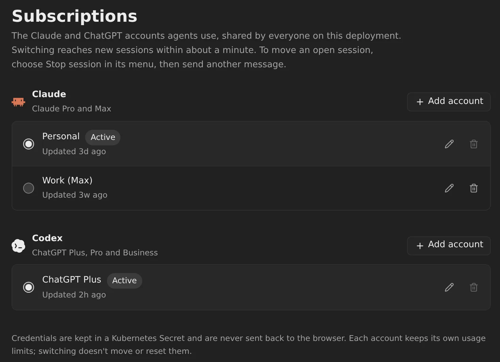
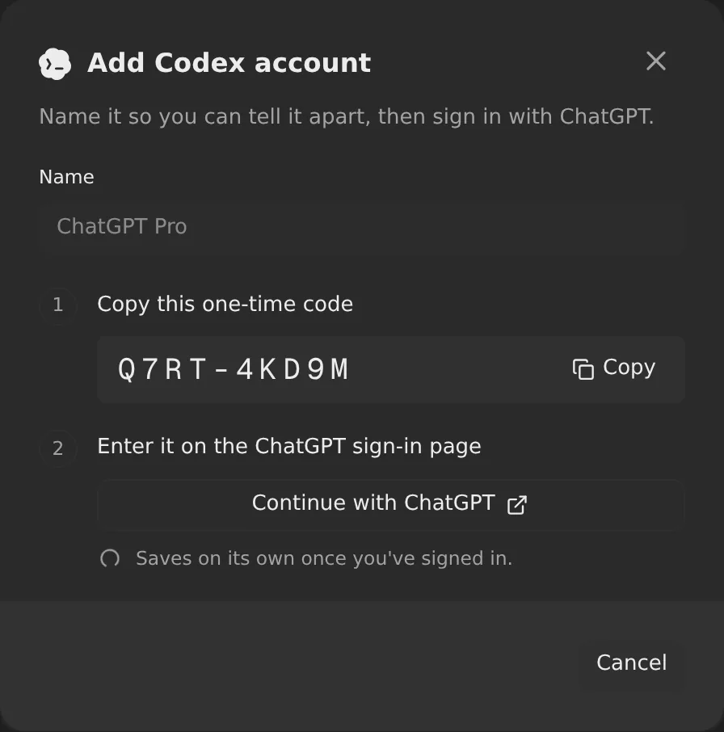
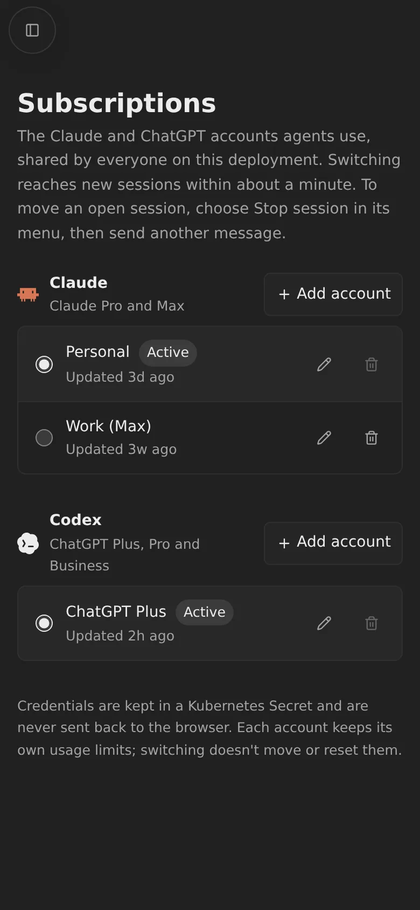

# Subscriptions in Settings

Admins keep named Claude and ChatGPT accounts in **Settings → Subscriptions**,
such as Personal and Work, and choose which one agents use for each provider.
The choice is shared by everyone on the deployment, and Claude and Codex can
use different accounts. Switching needs no deploy and no `setup-claude` or
`setup-codex` run.

## Adding an account

Choose **Add account** next to Claude or Codex, give the account a name, and
sign in. Everything runs in Omnigent; you only need a browser.

- **Claude:** choose **Sign in with Claude**, then **Continue with Claude**.
  Sign in and approve access, then paste the whole code Claude shows,
  including the part after `#`, and choose **Finish sign-in**. If Claude
  rejects the code, the dialog says so and you can start again. This is
  [Claude Code's own setup-token flow](https://code.claude.com/docs/en/authentication),
  run on the server.
- **Codex:** choose **Sign in with ChatGPT**. Copy the one-time code, choose
  **Continue with ChatGPT** and enter it there. The account is saved as soon
  as you've signed in. If ChatGPT refuses the code, turn on device-code
  sign-in in ChatGPT's security settings.

You can also import a login you already have: **Already have a token? Import
instead** takes a token from `claude setup-token`, and **Already have an
auth.json? Import instead** takes a Codex `auth.json` from a ChatGPT login.
API-key logins aren't accepted.

The first account for a provider becomes active; adding more keeps the current
choice.

## Switching accounts

Select another account in the provider's list. It is marked **Active**, and
reaches new sessions within about a minute, once Kubernetes has synced it into
the runner Pods.

A session that's already open keeps its account until its agent restarts:
choose **Stop session** in its menu, then send another message. Interrupting a
turn doesn't switch it, and a switch never interrupts a running turn.

Each account keeps its own usage limits, so the numbers in the composer follow
the account a session uses.

## Editing and removing

The pencil renames an account, or signs in again to replace its login.
Renaming without signing in keeps the saved login. The bin removes an account;
switch to another one first, since the active account can't be removed.
Removing deletes the saved login from this deployment but doesn't sign it out
with Claude or ChatGPT.

## Good to know

- **Until you add an account**, a provider keeps the login from
  `mise run setup-claude` or `mise run setup-codex`. Once it has one, the
  account selected here wins, and there's no way back short of deleting the
  `omnigent-subscriptions` Secret.
- **Two Codex processes in one session share a login.** Codex saves refreshed
  tokens back into its login, so a session only moves to a newly selected
  Codex account once none of its Codex processes still uses the old one.
  Stopping the session does that.
- **Runners from before this feature** need to be recreated once to get the
  subscriptions mount. A sleeping session gets it when it wakes.
- **`mise run credential-status`** lists the accounts by name and which one is
  active, never a credential.
- This is for a trusted team, not isolation between users: every runner gets
  the active logins, and Codex's shared volume keeps the logins of every
  Codex account a runner has used. See the [threat model](../threat-model.md).

## Turning it off

Don't add an account. To go back after adding one, delete the
`omnigent-subscriptions` Secret in `omnigent-sandboxes`. New sessions then use
the mise-stored logins again; a Codex session started before keeps the
subscription login it had.

## How it works

- **Storage:** the account list and every credential are the `store.json` key
  of the `omnigent-subscriptions` Secret in `omnigent-sandboxes`
  (`images/server/omnigent_subscriptions.py`). The same Secret holds the active
  credentials as `claude-token` and `codex-auth.json`, and their account IDs
  and revisions as `selection.json`. Saves replace the Secret only if nobody
  changed it since it was read; otherwise the page asks you to reload.
- **The Settings page** (`images/server/web-patches/0017-subscriptions.patch`)
  calls `/v1/subscriptions`, which `images/server/omnigent_subscriptions_api.py`
  serves (mounted by `images/server/patches/0013-subscriptions.patch`). Every
  route is admin-only, and no response contains a credential.
- **Browser sign-in** (`images/server/omnigent_subscription_login.py`): each
  sign-in is a `subscription-login-*` Pod running the runner image, with no
  service-account token, no credentials mounted, a 15-minute deadline and at
  most three at a time. For Codex it runs `codex login --device-auth`, and the
  server reads the device code from its log. For Claude it runs
  `images/runner/subscription-login.py`, which drives `claude setup-token` in a
  terminal emulator so the token never reaches the Pod log; the pasted code
  goes in through exec stdin. When the login completes, the server reads it
  over `pods/exec`, saves it and deletes the Pod. Cancelled sign-ins are
  deleted, and expired ones at the next sign-in.
- **Permissions:** the server may exec into Pods in `omnigent-sandboxes`
  (`kubernetes/platform/runner-rbac.yaml`). That's a platform change, so it
  needs `mise run bootstrap` once.
- **The Pod:** `0013-subscriptions.patch` mounts the Secret's active keys, not
  `store.json`, at `/run/omnigent/subscriptions/` in every runner Pod.
  Kubernetes updates the mount when the selection changes.
- **The agents:** the `claude` and `codex` wrappers run
  `images/runner/subscriptions.py` before starting the real CLI. Claude gets
  the active token as `CLAUDE_CODE_OAUTH_TOKEN`. Codex gets a writable copy of
  the active login at `/mnt/codex-home/subscriptions/<account>/auth.json` on
  the `codex-home` volume, linked as `auth.json` in its `CODEX_HOME`, so
  refreshed tokens survive switching away and back. A new revision, from
  signing in again, replaces the copy. Every Codex process holds a lock on its
  `CODEX_HOME`, and the wrapper only moves the link while nobody holds it.
- **Runner patches:** `images/runner/patches/0008-subscription-readiness.patch`
  makes Codex count the mounted login as signed in, and keys its model cache
  by the selection. `0009-stop-codex-process.patch` makes **Stop session**
  close Codex's app-server, so the next message starts it with the current
  account, as Claude already did.
