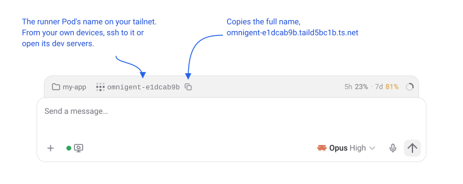

# Sessions on your tailnet

Each session's Pod can join your tailnet. From your own devices you can then
SSH into the session, or open a dev server the agent started.

## What you'll see

The composer shows the session's Tailscale name next to the working
directory. A button next to it copies the full name:

```
omnigent-e1dcab9b                      what the composer shows
omnigent-e1dcab9b.taild5bc1b.ts.net    what the copy button copies
```



The name stays the same for as long as the session exists, including after an
[idle session](idle-sessions.md) stops and wakes.

## Using it

From a device on your tailnet:

```bash
ssh root@omnigent-e1dcab9b               # a shell in the Pod
curl http://omnigent-e1dcab9b:3000       # a dev server the agent started
```

- **Every port is reachable** that a process in the Pod listens on, whether
  it listens on `localhost` or on all addresses.
- **The short name needs MagicDNS** on your device. The full name works
  either way.
- **To open the session in IntelliJ**, see
  [JetBrains Gateway](jetbrains-gateway.md).

## Reaching your devices from a session

Agents can also connect out to devices on your tailnet, but only to those
your tailnet policy lets sessions reach. Sessions get no access of their own
(see [step 1](#1-add-a-tag-for-sessions-to-your-tailnet-policy)), so give
them access to each device you want them to use. For example, for devices
tagged `tag:agent-target`:

```json
"grants": [
  {"src": ["tag:omnigent-runner"], "dst": ["tag:agent-target"], "ip": ["*"]}
],
"ssh": [
  {"action": "accept", "src": ["tag:omnigent-runner"], "dst": ["tag:agent-target"], "users": ["root"]}
]
```

Every session gets that access, so only give it to devices meant for agents.
See the [threat model](../threat-model.md#runners-on-your-tailnet).

In the session:

- **SSH works as usual:** `ssh root@my-server`, with the short name, the full
  `.ts.net` name or a `100.x` address.
- **Other tools go through a proxy** on `localhost:1055`, which speaks SOCKS5
  and HTTP and resolves MagicDNS names. Without it, tailnet names don't
  resolve and tailnet addresses don't connect.
  - curl: `curl --proxy socks5h://localhost:1055 http://my-server:3000`
  - Chromium or Playwright: `--proxy-server=socks5://localhost:1055`
- **The agent's browser tools** (`browser_navigate` and the others) drive the
  browser in your Omnigent desktop app, so they reach whatever your own device
  reaches, without the proxy.

## Set it up

### 1. Add a tag for sessions to your tailnet policy

In your [tailnet policy](https://login.tailscale.com/admin/acls):

- add a tag for sessions
- let your own devices reach it
- give the tag no access of its own

Keep it separate from the VM's `tag:omnigent`, so access you give one doesn't
also apply to the other. For example:

```json
"tagOwners": {"tag:omnigent-runner": ["autogroup:admin"]},
"grants": [
  {"src": ["autogroup:member"], "dst": ["tag:omnigent-runner"], "ip": ["*"]}
],
"ssh": [
  {"action": "accept", "src": ["autogroup:member"], "dst": ["tag:omnigent-runner"], "users": ["root"]}
]
```

> **Check your other rules.** Make sure no other rule, such as the default
> allow-all one, lets `tag:omnigent-runner` reach your other devices. See the
> [threat model](../threat-model.md#runners-on-your-tailnet) for why.

### 2. Create an OAuth client

Create an [OAuth client](https://login.tailscale.com/admin/settings/oauth)
with the **Auth Keys: Write** scope and only the `tag:omnigent-runner` tag.
It can only create keys for that tag.

A reusable, ephemeral, pre-approved auth key with the tag also works, but it
expires within 90 days.

### 3. Store it

```bash
mise run setup-tailscale
```

Paste the client secret or key when it asks.

### 4. Set your tailnet name and deploy

In `environments/production.toml`, set `tailscale_tailnet` to your tailnet's
MagicDNS suffix, from the [DNS page](https://login.tailscale.com/admin/dns).
Then deploy.

New sessions join straight away. Existing sessions join, and show their name,
the next time their Pod wakes.

To use a different tag, set `tailscale_tags` (comma-separated), and create
the OAuth client with that tag.

## The SSH shell

An SSH login gets zsh with oh-my-zsh, inside a tmux session named after the
Pod, such as `omnigent-e1dcab9b`.

- **Detaching from tmux also ends the SSH session.** Run
  `detach-without-exit` to detach and stay connected.
- **Agents aren't affected.** They still use bash and their own tmux.
- **Your shell history is lost** when an idle Pod stops. `/home/omnigent`,
  where the agents' files are, is kept.

This shell setup is one person's taste. To make it your own, change the files
in `images/runner/shell/`:

- `install.sh` lists the packages and pinned repositories to install, and
  copies the config files into `/root`.
- `bash_profile` switches SSH logins from bash to zsh. To use another shell,
  point it at that one instead.
- To go without, delete that directory and the two lines that use it at the
  end of `images/runner/Dockerfile`.

## Good to know

- **Stopped sessions don't pile up** in your machine list. Each Pod joins as
  an ephemeral node and logs out as it stops, so Tailscale removes it straight
  away. A woken Pod joins again under the same name.
- **Ephemeral nodes use up minutes.** Tailscale's plans include a monthly pool
  of minutes for ephemeral nodes, 1,000 on the free plan, counted for as long
  as each node is in the tailnet. See
  [Tailscale's pricing](https://tailscale.com/pricing).
- **No name in the composer, or the name doesn't connect?** Check
  `/run/omnigent-tailscale.log` in the Pod, or `mise run credential-status`
  for the key. The server works the name out itself rather than asking the
  Pod, so the composer shows it even if the Pod couldn't join.

## Turning it off

It's an optional setup step. Sessions don't join your tailnet until you store
a key.

## How it works

- **Runner image:** installs the pinned `tailscale` and `tailscaled`
  binaries (`tailscale` and `tailscale_sha256` in `versions.yaml`).
- **Joining:** `images/runner/tailscale/tailscale-service.sh` starts with the
  Pod, like the Podman service.
  - It joins as `omnigent-` plus the first 8 characters of
    `OMNIGENT_HOST_ID`, with `--ssh` and the tags in
    `OMNIGENT_TAILSCALE_TAGS`.
  - The Pod has no TUN device, so `tailscaled` uses userspace networking.
    The Pod gets no route to the tailnet and no MagicDNS, so connections out
    have to go through `tailscaled`.
- **Connecting out:**
  - `images/runner/tailscale/ssh-tailnet.conf`, in
    `/etc/ssh/ssh_config.d/`, sends SSH to tailnet hosts through
    `tailscale nc`, and accepts their host keys the first time.
  - `tailscaled` serves a SOCKS5 and an HTTP proxy on `localhost:1055`
    (`--socks5-server` and `--outbound-http-proxy-listen`). Nothing is set to
    use it by default, so the rest of the Pod's traffic doesn't depend on
    Tailscale.
- **Leaving:** the admission policy in
  `kubernetes/platform/runner-userns.yaml` gives the Pod a `preStop` hook,
  `images/runner/tailscale/tailscale-logout.sh`.
  - It runs `tailscale logout`, which removes an ephemeral node at once.
    Otherwise Tailscale removes it 30 to 60 minutes after it goes offline,
    which is still what happens when a Pod stops without running the hook.
  - It gives up after 10 seconds and never fails, so the Pod still stops.
- **Key:** `TAILSCALE_AUTHKEY` in the `omnigent-creds` Secret. An OAuth client
  secret gets `?ephemeral=true&preauthorized=true`, so each Pod creates its
  own ephemeral, pre-approved key.
- **Same name after a wake:** the node's state is kept in
  `~/.local/state/omnigent-tailscale` in the session's home directory.
  - A Pod that logged out as it stopped wakes as a new node, under the same
    name and with the same SSH host keys, which stay in that directory.
  - A Pod that stopped without logging out, and wakes before Tailscale
    removes its node, rejoins as the same node.
  - If Omnigent has to rebuild a lost sandbox from scratch while the old node
    is still listed, Tailscale names the new node `omnigent-e1dcab9b-1`. The
    Pod logs that to `/run/omnigent-tailscale.log`. The name in the composer
    won't reach it until the old node is gone.
- **SSH shell** (`images/runner/shell/`):
  - `install.sh` installs zsh, and puts oh-my-zsh, the tmux config, tpm, its
    plugins and the catppuccin theme in `/root`, at the commits pinned in the
    script.
  - Tailscale SSH sets `HOME` to `/root`, the home directory in root's passwd
    entry. Agents and Pod startup use `HOME=/home/omnigent`, so they never
    read these files.
  - Root's login shell stays bash, because Pod startup relies on
    `/etc/profile.d`. `/root/.bash_profile` switches to zsh only when
    `SSH_CONNECTION` is set.
- **Server** (`images/server/patches/0003-tailscale-host.patch`): when it
  starts or wakes a session's Pod, it works out the same name, adds
  `OMNIGENT_TAILSCALE_TAILNET`, stores it in the `omnigent.tailscale_host`
  session label, and sends it to open browsers.
- **Web UI** (`images/server/web-patches/0002-composer-tailscale-host.patch`):
  adds the `ComposerTailscaleHost` chip.
